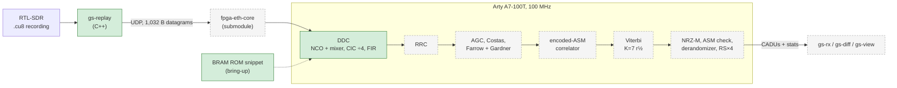
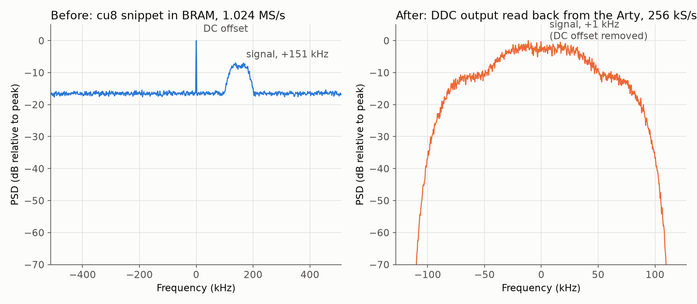
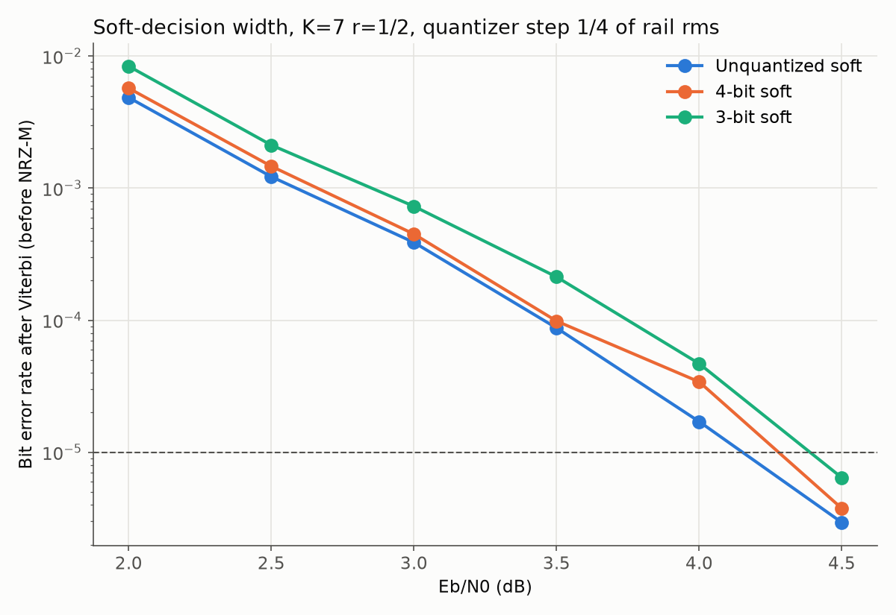
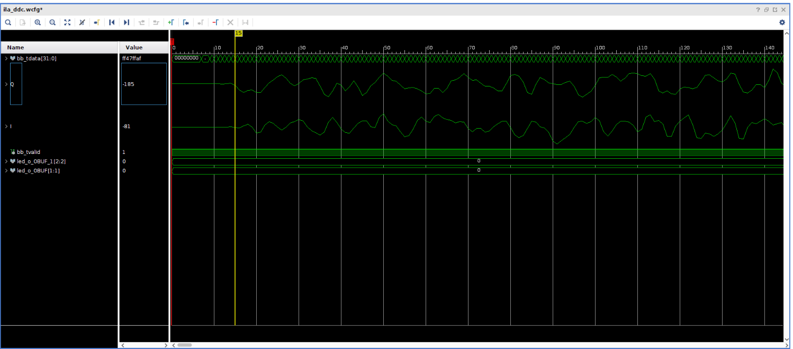

# A Meteor-M LRPT Satellite Receiver in SystemVerilog, Bit-Exact Against Its Golden Model on an Arty A7

[](https://github.com/RodeanAzari/ccsds-meteor-lrpt-receiver/actions/workflows/ci.yml)

A receiver for the **Meteor-M N2-4 LRPT downlink (72k mode, OQPSK, 72 ksym/s)**, built as an FPGA datapath on a
Digilent Arty A7-100T with C++ ground-station tools around it. Recordings are captured with an RTL-SDR, replayed to
the board over UDP, and decoded down to CCSDS frames: digital downconversion, timing and carrier recovery, frame
sync, Viterbi K=7 r½, derandomization and Reed-Solomon RS(255,223)×4.

**Status: Phase B of six.** The full receive chain exists as a Python model. It decodes synthetic signals end to end
and agrees with BER theory, and SatDump, the reference decoder, decodes the model's synthetic recording with every
frame matching. The first RTL block, the **digital downconverter, runs on the board at 100 MHz** and matches the
bit-true model on **all 16,384 outputs, read back two independent ways** (UART and JTAG/ILA). No real satellite
recording has been decoded yet; the capture kit arrives around 2026-11-25.

Every number below comes from a CSV in [`data/results/`](data/results/) or a report in
[`docs/reports/`](docs/reports/), produced by a `make` target. Each CSV has a sidecar `.md` with the commit,
command, tool versions, input and an interpretation. `[TBD]` means not measured yet.

[](docs/media/2026-11-04_phase-b_ddc-ila-baseband.png)

*The downconverter's output, captured on the running Arty A7 by an integrated logic analyzer (lines), on top of the
Python bit-true model's output for the same input (dots): 16,384 of 16,384 samples identical. The input is a
synthetic OQPSK snippet at 8 dB Eb/N0 in block RAM. On the right, the unsynchronized I/Q: a noisy ring, still
rotating at the 1 kHz residual carrier. Timing and carrier recovery (Phase C) turn it into four clusters. This is a
stand-in hero image: the intended one, a Meteor image decoded by this receiver next to SatDump's, needs Phases C–F.
`make plots`, from [`ddc_board_ila_iq.csv`](data/results/ddc_board_ila_iq.csv).*

## At a glance

| | |
|---|---|
| **Target signal** | Meteor-M N2-4 LRPT, 72k mode: OQPSK, 72 ksym/s, conv K=7 r½, NRZ-M, CCSDS randomizer, RS(255,223) interleave 4. Parameters read from SatDump 1.2.2's source ([signal-spec.md](docs/signal-spec.md)) |
| **Receive chain** | DDC (NCO + mixer, CIC ÷4, 31-tap droop FIR) → RRC → Costas + Farrow/Gardner → encoded-ASM sync → Viterbi → NRZ-M → derandomizer → RS×4. **In RTL: the DDC (on the board); the RRC, AGC, Costas loop and Farrow/Gardner timing (simulation).** The rest is in the model |
| **Real passes decoded** | 0. No recording yet; capture kit arrives about 2026-11-25 |
| **CADU match vs. SatDump** | Synthetic recording: SatDump decoded 258 / 295 / 226 of 300 frames in three runs, **every decoded frame matching** ([satdump_crosscheck.csv](data/results/satdump_crosscheck.csv)). Real pass: `[TBD]` |
| **DDC on the board** | **16,384 / 16,384 outputs bit-exact** vs. the model, over UART ([ddc_board.csv](data/results/ddc_board.csv)) and again over JTAG/ILA ([ddc_board_ila.csv](data/results/ddc_board_ila.csv)); 100 MHz, synthetic input |
| **DDC throughput** | 9.0 clocks per input sample: **10.8× real time** at 100 MHz, RTL simulation ([ddc_rtl_sim.csv](data/results/ddc_rtl_sim.csv)) |
| **Coding gain at BER 10⁻⁵** | Model only, before NRZ-M: 10⁻⁵ at 4.28 dB with 4-bit soft decisions (4.15 dB unquantized) against 9.59 dB for uncoded OQPSK theory, a 5.3 dB gain (5.4 dB unquantized) ([soft_width_ber.csv](data/results/soft_width_ber.csv)). Hardware: `[TBD]` |
| **Viterbi throughput and headroom** | `[TBD]` (Phase D) |
| **Lock / Doppler** | Bit-true model tracks a **3.4 kHz offset (the Doppler maximum) with a 30 Hz/s ramp**, 1.7–4.0 Hz rms error ([sync_fixed_chain.csv](data/results/sync_fixed_chain.csv)). Lock time in hardware: `[TBD]` |
| **Formal proofs** | None yet (`[TBD]`: Viterbi normalization, sync FSM, AXI-Stream, RS syndromes) |
| **Bugs caught** | 15 written up as symptom → root cause → fix ([below](#bugs-found)); 18 planted bugs, all caught |
| **Fmax** | DDC out of context **100 MHz met, WNS +0.661 ns**; board build WNS +1.521 ns; RRC +2.453 ns, AGC +2.344 ns, Costas +2.360 ns and timing +0.745 ns out of context ([synth_ddc_top.csv](data/results/synth_ddc_top.csv), [board_arty_ddc_rom_top.csv](data/results/board_arty_ddc_rom_top.csv), [synth_sync_rrc.csv](data/results/synth_sync_rrc.csv), [synth_sync_agc.csv](data/results/synth_sync_agc.csv), [synth_sync_costas.csv](data/results/synth_sync_costas.csv), [synth_sync_timing.csv](data/results/synth_sync_timing.csv)) |
| **Utilization** | DDC: 1,036 LUT, 1,659 FF, 6 DSP48E1, 1 RAMB18, **1.6% of the LUTs**. RRC: 616 LUT, 1,874 FF, 2 DSP48E1. AGC: 163 LUT, 68 FF, 4 DSP48E1. Costas: 469 LUT, 153 FF, 7 DSP48E1, 1 RAMB18. Timing: 938 LUT, 504 FF, 7 DSP48E1. Every multiplier in a DSP |
| **Ground station + CI** | `gs-replay` (C++20): 68,266 / 68,266 datagrams in order and byte-exact at 1× and 5× on loopback ([gs_replay_loopback.csv](data/results/gs_replay_loopback.csv)). `make ci`, run by [GitHub Actions on every push](https://github.com/RodeanAzari/ccsds-meteor-lrpt-receiver/actions/workflows/ci.yml): ruff, mypy, Verilator lint, 63 pytest, 27 cocotb, 8 GoogleTest (Release + ASan/UBSan), 4 loopback, clang-format, clang-tidy, cppcheck |

## Status

| Phase | State | Key result |
|---|---|---|
| 0 — Signal spec + capture kit | **In progress** | [signal-spec.md](docs/signal-spec.md) from SatDump's source; not yet confirmed on a real signal |
| A — Python golden model | **In progress** | Float and bit-true chains decode synthetic signals; real recording pending |
| B — Digital downconverter | **In progress** | Bit-exact on the board; Ethernet replay waits on `eth-core-v0.1` |
| C — Synchronization | **In progress** | RRC, AGC, Costas and Farrow/Gardner RTL bit-exact in simulation; chain test and lock measurements next |
| D — Viterbi + frame sync | Not started (RTL) | Bit-true model done |
| E — Reed-Solomon + real decode | Not started | — |
| F — C++ ground station | Not started (`gs-replay` done in B) | — |

Architecture, ADR summary and clock-domain crossings: [docs/design.md](docs/design.md). Lab notebook with every
measurement and bug: [docs/log.md](docs/log.md). Current state and next steps: [progress.md](progress.md).

**Blocked on another project:** streaming full passes to the board needs the shared Ethernet core `fpga-eth-core`
at tag `eth-core-v0.1`, and sending frames back needs `eth-core-v0.2`. Until then, hardware tests play IQ snippets
from block RAM and read results over UART or the ILA.

## Architecture



Green is built and verified; grey dashed is not built yet. The Python model covers the whole signal path, but not the Ethernet core or the host tools.

- **Clocking:** one 100 MHz domain. The DDC needs 9.0 clocks per sample against 97.7 available at 1.024 MS/s. The
  only crossings today are the asynchronous RESET and BTN0 inputs: a reset synchronizer and a two-flop synchronizer,
  both false-pathed in XDC and listed in [design.md](docs/design.md).
- **Interfaces:** AXI4-Stream between every block, with I and Q in one beat (`tdata = {Q, I}`). Every block honours
  backpressure, and pipelines stall as a whole, so nothing is dropped and the rails never skew.
- **Data flow:** raw 8-bit unsigned I/Q at 1.024 MS/s, tuned 150 kHz off the signal to keep the RTL-SDR's DC spike
  out of band; the DDC mixes it to baseband and decimates to 256 kS/s (3.56 samples per symbol).
- **Fixed point:** every signal's width, rounding and saturation is in [fixed-point.md](docs/fixed-point.md), and the
  bit-true model uses exactly the same, so RTL tests compare for equality, not tolerance.
- **Packet formats:** [protocol.md](docs/protocol.md), the single source for the RTL and the C++ tools.

## Verification

Three layers so far, each checked against the layer above it. Nothing is called done until the layer below
reproduces the layer above bit for bit.

**Models** (`make model-test`, pytest, 63 tests including the host-side board scripts):

- The float model is checked against theory: uncoded BER matches Q(√(2Eb/N₀)) at every point from 0 to 8 dB, and
  soft Viterbi sits on the union bound from 3.5 dB up (1.79×10⁻⁵ measured vs. 1.81×10⁻⁵ at 4.0 dB)
  ([ber_awgn.csv](data/results/ber_awgn.csv)). The RS encoder is checked against libcorrect built from SatDump's own
  source, and the codec is also tested as RS(544,514) over GF(2¹⁰).
- **SatDump cross-check:** SatDump 1.2.2 decoded the model's synthetic recording, and every frame it wrote matches
  the truth. So our transmitter and SatDump's receiver agree without anyone having to trust this repo's receiver.
- The bit-true model (DDC, RRC, AGC, Costas, Farrow, Gardner, Viterbi) decodes the same frames as the float model at
  every tested point, which is what lets RTL tests use exact comparison.

**cocotb on Verilator** (`make sim`, 27 tests): each DDC block and the whole chain, bit-exact against
`model/ddc_fixed.py` on a modulated OQPSK signal with a Doppler ramp and DC offset, **under random input gaps and
output stalls**. Each sync block (RRC, AGC, Costas, Farrow/Gardner timing) is bit-exact against
`model/rrc_fixed.py` / `model/sync_fixed.py` the same way, with the loops driven through pull-in and their clamps. The board top is simulated too: the testbench decodes the UART pin and checks every dumped word.
Coverage bins: `[TBD]`.

**On the hardware:** the board top plays a 65,536-sample synthetic snippet from BRAM through the DDC at full speed.
All 16,384 outputs are checked two ways: a CRC-protected UART dump (`make board-check`), and an ILA capture over
JTAG, storage-qualified on the output handshake so the whole output fits in the buffer (`make ila-capture`).
Both match the model with 0 mismatches. A script checks the ILA capture, which also proves the trigger alignment
and probe bit order.

**Formal:** none yet. Planned in [CLAUDE.md §8.3](CLAUDE.md): Viterbi path-metric overflow, the sync FSM,
AXI-Stream handshakes, and RS syndromes.

### Bugs found

Each one is written up as symptom → root cause → fix in [docs/log.md](docs/log.md).

| # | Bug | Caught by |
|---|---|---|
| 1 | The architecture had no NRZ-M decoder, so no ASM would ever have matched. SatDump's pipeline uses one (ADR 0001) | Reading SatDump's source (Phase 0) |
| 2 | Sync threshold 0.55 sat inside the random-data correlation range (≈ 0.6–0.7), so the receiver locked a wrong phase and the flywheel held it | Model test: Q-leading signal gave 0 frames |
| 3 | After a cycle slip, frame search restarted inside the flywheel window and re-found emitted frames: 223 out of 200 sent | Model frame counting |
| 4 | The SatDump cross-check script sliced a (frames, 1024) array as a flat byte stream and reported 0 of 258 matching | Manual check disagreed |
| 5 | CIC integrators, combs, rounding and saturation in one cycle: missed 100 MHz by 3.262 ns | Vivado out-of-context timing |
| 6 | DC-block accumulator fed straight from BRAM: board build missed by 0.155 ns | Vivado board timing |
| 7 | 16,169 of 16,384 "DDC errors" on the board. The DDC was right: opening the serial port resets the design, and the host read a cut-off dump into the next one. Fixed with a CRC-32 trailer | Board run |
| 8 | `capture_dump` would have sent each word's predecessor (BRAM read one cycle early) | Review, before simulation |
| 9 | The default NCO word was written as `0x0258_0000` instead of `0x2580_0000` (150 kHz) | Review, before simulation |
| 10 | The "before" spectrum showed a notch at DC instead of the DC offset: Welch detrending | Plot review |
| 11 | The DC-step test settled for only 2.9 time constants, so it read 496 instead of 510 (a test bug; the RTL matched throughout) | cocotb |
| 12 | The Farrow test asserted ≤ 1 LSB error; the derived bound for its four roundings is 1.25 LSB (a test bug) | Model test |
| 13 | `fixed-point.md` said the AGC settles near gain 4; measured 5.9–9.8 | Measurement vs. doc |
| 14 | Vivado deletes the `.mem` copies in its run directory at exit, and the ROM was generated there | Second Vivado run in the same directory |
| 15 | Synthesis absorbed and renamed `bb_tready`, so ILA insertion by net name failed. The ILA now probes the equivalent `full` flag, and the build fails loudly on any rename | ILA build |
| 16 | The timing lock test had a 100 ppm clock error, which drifted the half-symbol offset to ~0.05 symbol over the run, so a dead loop would have passed too (a test bug). The test's no-loop baseline guard failed; the lock run now has no clock error | cocotb baseline guard |

**Planted bugs, each caught:**
- DDC: DC accumulator 4 bits short; a sign error in one NCO quadrant; CIC registers one bit short (caught only by
  the full-scale test, since 21 bits suffice at the mixer's real signal level); the FIR dropping its last tap.
- Sync: AGC target doubled; Costas integrator without fraction bits; a Farrow coefficient sign.
- Sync RTL: Costas phase updated with the previous sample's frequency; Costas sgn(0) taken as +1; Costas upper
  frequency clamp removed; Gardner detector always on the I rail; timing integrator clamp removed (caught only by
  the clamp test).
- Viterbi: plain comparison on wrapped path metrics; quantizer offset by one; traceback one step off; the
  best-state start ignored.
- Board: the capture buffer's stale-read bug put back; the ILA parser with I and Q swapped.
- `gs-replay`: sequence number written little-endian; pacing removed.

## Digital downconverter

Mixes the signal from its 150 kHz tuning offset to baseband and decimates 1.024 MS/s → 256 kS/s:
`ddc_ingest` (cu8 → signed, DC block pipelined over three stages) → `ddc_nco_mixer` → `ddc_cic` → `ddc_comp_fir`.

| Choice | Options considered | Chosen | Evidence |
|---|---|---|---|
| NCO ([ADR 0003](docs/decisions/0003-nco.md)) | Quarter-wave table; full-wave table; 16-stage CORDIC; table + dither | 32-bit phase accumulator, 12-bit quarter-wave table of s16, half-step offset so quadrants mirror cleanly | SFDR 71.6–72.8 dB over 64 random tuning words, matching the ≈ 72 dB 12-bit estimate ([ddc_nco_sfdr.csv](data/results/ddc_nco_sfdr.csv)) |
| Decimation ([ADR 0004](docs/decisions/0004-cic.md)) | CIC order 3 + droop FIR; polyphase FIR alone; CIC order 4–5; two half-bands | CIC ÷4, order 3, 22-bit registers, then a 31-tap droop FIR with one time-shared multiplier per rail | Bit-true DDC SQNR 51–54 dB; same frames and soft SNR as the float DDC ([ddc_fixed_chain.csv](data/results/ddc_fixed_chain.csv)) |

**Cost, out of context at 100 MHz** ([synth_ddc_top.csv](data/results/synth_ddc_top.csv)):

| Block | LUT | FF | DSP48E1 | RAMB18 |
|---|---|---|---|---|
| `ddc_ingest` | 185 | 86 | 0 | 0 |
| `ddc_nco_mixer` | 196 | 106 | 4 | 1 |
| `ddc_cic` | 279 | 434 | 0 | 0 |
| `ddc_comp_fir` | 379 | 1,033 | 2 | 0 |
| **`ddc_top`** | **1,036** | **1,659** | **6** | **1** |

WNS +0.661 ns, WHS +0.112 ns. The FIR's flip-flops are mostly its 31-sample history on both rails, which is cheap
to move into SRLs if area ever matters.

**Verified by:** bit-exact cocotb tests per block and for the chain under backpressure; four planted bugs; and on the
board, two independent readouts, both bit-exact.



*Left: the cu8 snippet in BRAM, signal at +151 kHz with a DC offset. Right: the board's DDC output at 256 kS/s,
signal at +1 kHz (the residual left for the Costas loop), DC removed. From
[ddc_board_spectrum.csv](data/results/ddc_board_spectrum.csv).*

## Timing and carrier recovery

The design is in the bit-true model; the RTL is Phase C. The OQPSK stagger is the hard part: Q is offset by half a
symbol, so a plain QPSK timing detector sees the Q rail at the wrong instants.

| Loop order ([ADR 0002](docs/decisions/0002-oqpsk-timing.md)) | Frames of 48 at 0 / 300 / 1,000 / 3,000 Hz offset |
|---|---|
| **Costas first, then per-rail Gardner at 2 sps** | **48 / 48 / 48 / 48** |
| Per-rail Gardner first, then Costas | 9 / 48 / 16 / 42 |
| Plain QPSK Gardner first | 0 / 0 / 0 / 0 |

([sync_loop_order.csv](data/results/sync_loop_order.csv)) A per-rail detector running on an unresolved carrier sees
the other rail half a symbol off, which scales its error by cos 2θ, so it averages to zero while the carrier rotates.

- **Acquisition:** a Costas loop narrow enough to track well doesn't pull in from 2–3.4 kHz within 3.4 s
  ([sync_pull_in.csv](data/results/sync_pull_in.csv)). So a coarse estimate from the fourth-power spectral line
  comes first, computed on the host and loaded into the DDC's NCO word. That way there's no FFT hardware, and the RRC
  sees a centred signal.
- **Chosen:** Costas 0.001 rad/sample; Farrow cubic to 2 sps; per-rail Gardner, kp 0.02; AGC on I²+Q² power.
- **Measured (model):** at 3.4 kHz with a 30 Hz/s ramp, the bit-true chain decodes the same frames as float from 2
  to 8 dB, and tracks frequency with 1.7–4.0 Hz rms error. AGC settles in 60–104 ms
  ([sync_fixed_chain.csv](data/results/sync_fixed_chain.csv), [sync_agc_settle.csv](data/results/sync_agc_settle.csv)).
- **RTL so far:** the RRC (`rtl/sync/sync_rrc.sv`) reuses the DDC's time-shared FIR with the 57 RRC taps, since the
  arithmetic is identical. 4,000 / 4,000 outputs bit-exact against the model under random backpressure, 62 clocks per
  sample (6.3× real time), WNS +2.453 ns at 100 MHz out of context ([rrc_rtl_sim.csv](data/results/rrc_rtl_sim.csv),
  [synth_sync_rrc.csv](data/results/synth_sync_rrc.csv)).
- **AGC RTL:** `rtl/sync/sync_agc.sv`, one sample at a time through a 5-stage pipeline so each gain update lands
  before the next sample (the model's loop is per sample). 16,500 outputs bit-exact against the model, including a
  full-scale burst that overflows s16; 6 clocks per sample (65× real time); WNS +2.344 ns, 4 DSP48E1
  ([agc_rtl_sim.csv](data/results/agc_rtl_sim.csv), [synth_sync_agc.csv](data/results/synth_sync_agc.csv)). The
  gain step has a dead zone of ±25% in power, so on a constant-envelope input the AGC settles anywhere in 0.87–1.12
  of the target rms; noise dithers it on real signals ([fixed-point.md](docs/fixed-point.md)).
- **Costas RTL:** `rtl/sync/sync_costas.sv`, one sample in flight like the AGC, reading its own copy of the DDC's
  sine table. 26,000 outputs bit-exact against the model: a 50 Hz post-coarse residual with a 30 Hz/s ramp, which the
  loop pulls in within the run (ends at 52.0 Hz), and a run held at a 20 Hz frequency clamp. 10 clocks per sample
  (39× real time); WNS +2.360 ns after splitting the phase detector over two stages (it was +0.512 ns in one)
  ([costas_rtl_sim.csv](data/results/costas_rtl_sim.csv), [synth_sync_costas.csv](data/results/synth_sync_costas.csv)).
- **Farrow/Gardner RTL:** `rtl/sync/sync_timing.sv`. Each output's Gardner error sets the next position, so outputs
  are produced one at a time: fill a 4-sample window, three Horner steps per rail, the detector on the rail the
  output belongs to, then the PI update. 14,619 outputs bit-exact against the model: an input starting half a symbol
  late, where the strobe eye ratio (mean/std of |soft|) ends at 2.08 against 1.48 with the loop off, and a 100 ppm run
  with the integrator limit at one ki step. 8.86 clocks per input sample (44× real time); WNS +0.745 ns after splitting
  the last Horner rounding from the output saturation (+0.583 ns in one stage)
  ([timing_rtl_sim.csv](data/results/timing_rtl_sim.csv), [synth_sync_timing.csv](data/results/synth_sync_timing.csv)).
- **Sync chain test, lock time on hardware, Doppler-tracking plot, constellation GIF:** `[TBD]`
  (Phase C).

## Frame sync and phase ambiguity

The ASM `0x1ACFFC1D` is convolutionally encoded with the data, so the receiver correlates soft symbols against the
*encoded* pattern, skipping its first 12 symbols because they depend on the previous frame. Because of NRZ-M
([ADR 0001](docs/decisions/0001-nrzm-decoder.md)), a 180° rotation is irrelevant, so the search covers
{0°, 90°} × I/Q swap on the absolute correlation. The winner gives both the frame position and the derotation.
SEARCH → VERIFY → LOCK with a flywheel; threshold 0.75, chosen after bugs 2 and 3 above.

Model only. RTL, sync-FSM formal proof and coverage of every hypothesis winning: `[TBD]` (Phase D).

## Viterbi decoder

64 states, fully parallel ACS. Decisions from the model, each with its ADR; RTL in Phase D.

| Decision | Options | Chosen | Evidence |
|---|---|---|---|
| Soft width ([0005](docs/decisions/0005-soft-decision-width.md)) | 3-bit, 4-bit | **4-bit**, step 1/4 of rail rms | At BER 10⁻⁵: unquantized 4.15 dB, 4-bit 4.28 dB (0.13 dB loss), 3-bit 4.39 dB (0.24 dB) ([soft_width_ber.csv](data/results/soft_width_ber.csv)) |
| Path metrics ([0006](docs/decisions/0006-path-metric-normalization.md)) | Modulo; subtract-minimum; subtract-on-threshold | **Modulo, 9 bits** | Candidate spread ≤ 7·BMmax = 210 < 256; largest spread seen 104 |
| Survivors ([0007](docs/decisions/0007-survivor-memory.md)) | BRAM + per-bit traceback; BRAM + chunked; register exchange (6,144 FF + 6,144 mux at D = 96) | **BRAM, per-bit traceback** | Bit-exact model of the scheme |
| Traceback depth ([0008](docs/decisions/0008-traceback-depth.md)) | Best-state start at 36–60; state-0 start at 48–96 | **96 from state 0** | +0.1% BER vs. full-block at 2.5 dB, equal at 3 and 4 dB; no 64-way minimum tree ([traceback_depth.csv](data/results/traceback_depth.csv)) |

Depth 96 is outside CLAUDE.md's 35–50 guideline. That range assumes a best-state start, and even then it measures
2–5% worse than full-block decoding at 2.5–3 dB. ADR 0008 explains the choice.



Throughput, area per soft width, path-metric overflow proof, hardware BER: `[TBD]` (Phase D).

## Reed-Solomon

RS(255,223) over GF(2⁸), field polynomial 0x187, generator roots α^(11j) for j = 112…143, interleave depth 4,
conventional basis (`rs_dualbasis: false` in SatDump's pipeline). The Python codec is parameterized and tested at
both CCSDS and KP4 RS(544,514)/GF(2¹⁰) parameters, because the RTL decoder will be shared with another project.
RTL: `[TBD]` (Phase E).

## Ground station

`gs-replay` (C++20, `gs/`) streams a recording to the board ([ADR 0009](docs/decisions/0009-iq-transport-format.md)).

| Datagram option | Wire efficiency | Max speed on 100 Mb/s | Chosen |
|---|---|---|---|
| **8-byte BE sequence + 512 raw cu8 samples (1,032 B)** | 94.0% | 5.69× real time | **Yes**: power-of-two sample count, matches the Ethernet core's test harness byte for byte |
| 8-byte sequence + 728 samples (fills a frame) | 95.7% | 5.81× | Awkward index math for 0.1× |
| Samples converted to 16-bit on the host | 47% | — | Doubles the bytes, and alters the data the model was checked on |

The speeds are arithmetic from frame overheads, not measurements. Pacing: real time, N× or flat out, against
absolute deadlines computed from the packet index, so jitter doesn't accumulate over a pass. Every run logs the
achieved rate, and a partial final datagram is reported, never silently dropped.

**Measured on loopback** ([gs_replay_loopback.csv](data/results/gs_replay_loopback.csv)): the 34 s synthetic
recording, 68,266 datagrams at 1× and 5×, all in order and byte-exact, 1.00× and 5.00× achieved. Not yet measured
over Ethernet to the board.

`gs-rx`, `gs-diff`, `gs-view` and the fuzzed packet parser: `[TBD]` (Phase F).

## On the board

The Phase B bring-up design: BRAM ROM (65,536-sample cu8 snippet) → DDC → capture BRAM → UART at 115,200 baud. It
replays once after every reset.

```
$ make prog board-check
openFPGALoader -b arty_a7_100t build/board/arty_ddc_rom_top.bit
...
waiting for a dump on /dev/ttyUSB1 (opening the port resets the board and starts one; BTN0 repeats it)...
16384 outputs, 0 mismatches
wrote data/results/ddc_board.csv
wrote data/results/ddc_board_spectrum.csv
```

([screenshot](docs/media/2026-11-05_phase-b_board-check-terminal.png))

**ILA capture.** `make board ILA=1` inserts an ILA after synthesis, leaving the RTL unchanged. It probes the DDC
output word, its valid, and the capture buffer's full flag (whose inverse is the ready). It stores only handshake
cycles, 16,384 deep, so one capture holds every output. Trigger and capture settings used:
[ila_capture_settings.txt](docs/reports/board/arty_ddc_rom_top_ila/ila_capture_settings.txt).



| ILA sample | `bb_tdata` | I | Q | What it shows |
|---|---|---|---|---|
| 0–6 | `00000000` | 0 | 0 | CIC and droop FIR filling after reset |
| 9 | — | −3 | −4 | Small values while the filters fill (samples 7–8 read Q = 1) |
| 15 | `ff47ffaf` | −81 | −185 | Cursor in the screenshot; same value as the model's sample 15 |
| every row | — | — | — | `bb_tvalid` = 1 and full = 0: only real handovers were stored |

The x-axis is the ILA sample index: one DDC output each, 3.906 µs apart at 256 kS/s.

## Demos

| Demo | Command | On-board result |
|---|---|---|
| DDC bit-exactness over UART | `make board prog board-check` | 16,384 outputs, 0 mismatches |
| DDC bit-exactness over JTAG | `make board ILA=1 && make ila-capture` | 16,384 outputs, 0 mismatches |
| Replay a recording over UDP | `build/gs-Release/gs-replay FILE.cu8 [--speed X]` | Loopback only, until `eth-core-v0.1` |
| Demo video | — | `[TBD]` (Phase F) |

Claim the shared board first: `python3 ~/fpga-coord/coord.py board claim P3 "<reason>"`.

## In Vivado

| Build | Timing | Utilization | Reports |
|---|---|---|---|
| `ddc_top`, out of context | WNS +0.661 ns, WHS +0.112 ns, 100 MHz | 1,036 LUT, 1,659 FF, 6 DSP, 1 RAMB18 | [docs/reports/ooc/ddc_top/](docs/reports/ooc/ddc_top/) |
| Board bring-up | WNS +1.521 ns, WHS +0.040 ns | 1,095 LUT, 1,853 FF, 6 DSP, 48 RAMB36 (ROM + capture), 1 RAMB18 | [docs/reports/board/arty_ddc_rom_top/](docs/reports/board/arty_ddc_rom_top/) |
| Board bring-up + ILA | WNS +1.750 ns, WHS +0.024 ns | 2,544 LUT, 4,314 FF, 6 DSP, 64 RAMB36, 1 RAMB18 | [docs/reports/board/arty_ddc_rom_top_ila/](docs/reports/board/arty_ddc_rom_top_ila/) |

Device view, worst-path and schematic screenshots: `[TBD]` (Phase E, full design).

## Results

Part `xc7a100tcsg324-1`, Vivado 2025.2, 100 MHz. All inputs synthetic until a real recording exists.

| Metric | Value | Conditions | Source |
|---|---|---|---|
| Uncoded BER vs. theory | Within counting error, 0–8 dB | Float model, AWGN | [ber_awgn.csv](data/results/ber_awgn.csv) |
| Soft Viterbi BER | 1.79×10⁻⁵ at 4.0 dB (union bound 1.81×10⁻⁵) | Float model, ≥ 100 errors per point | [ber_awgn.csv](data/results/ber_awgn.csv) |
| Eb/N₀ at 10⁻⁵, by soft width | 4.15 (unquantized) / 4.28 (4-bit) / 4.39 (3-bit) dB | Before NRZ-M, AWGN symbol channel | [soft_width_ber.csv](data/results/soft_width_ber.csv) |
| Full-chain frames | 190 / 200 from 2.5 dB; 183 at 2.0 dB | 1 kHz offset, 30 Hz/s ramp, 0.37-symbol timing offset, 20 ppm clock; the 10 missing are run edges | [fer_full_chain.csv](data/results/fer_full_chain.csv) |
| SatDump on our synthetic recording | 258 / 295 / 226 of 300 decoded; all match | 1 kHz + 30 Hz/s / 0 Hz / 1 kHz static | [satdump_crosscheck.csv](data/results/satdump_crosscheck.csv) |
| NCO SFDR | 71.6–72.8 dB | 64 random tuning words | [ddc_nco_sfdr.csv](data/results/ddc_nco_sfdr.csv) |
| Bit-true DDC SQNR | 51.0–53.7 dB | 2–8 dB Eb/N₀ | [ddc_fixed_chain.csv](data/results/ddc_fixed_chain.csv) |
| Frequency tracking error | 1.7–4.0 Hz rms | Bit-true, 1 and 3.4 kHz offsets, 30 Hz/s ramp | [sync_fixed_chain.csv](data/results/sync_fixed_chain.csv) |
| DDC RTL vs. model | 6,000 / 6,000 outputs bit-exact | Verilator, random backpressure, 6 dB OQPSK | [ddc_rtl_sim.csv](data/results/ddc_rtl_sim.csv) |
| DDC throughput | 9.0 clocks/sample, 10.8× real time | RTL simulation, 100 MHz | [ddc_rtl_sim.csv](data/results/ddc_rtl_sim.csv) |
| RRC RTL vs. model | 4,000 / 4,000 outputs bit-exact | Verilator, random backpressure, bit-true DDC output of 6 dB OQPSK | [rrc_rtl_sim.csv](data/results/rrc_rtl_sim.csv) |
| RRC throughput | 62 clocks/sample, 6.3× real time | RTL simulation, 100 MHz | [rrc_rtl_sim.csv](data/results/rrc_rtl_sim.csv) |
| AGC RTL vs. model | 16,500 / 16,500 outputs bit-exact | Verilator, random backpressure, RRC output of 6 dB OQPSK + full-scale burst | [agc_rtl_sim.csv](data/results/agc_rtl_sim.csv) |
| AGC throughput | 6 clocks/sample, 65× real time | RTL simulation, 100 MHz | [agc_rtl_sim.csv](data/results/agc_rtl_sim.csv) |
| Costas RTL vs. model | 26,000 / 26,000 outputs bit-exact; locks to the residual | Verilator, random backpressure, AGC output of 6 dB OQPSK, 50 Hz residual + 30 Hz/s | [costas_rtl_sim.csv](data/results/costas_rtl_sim.csv) |
| Costas throughput | 10 clocks/sample, 39× real time | RTL simulation, 100 MHz | [costas_rtl_sim.csv](data/results/costas_rtl_sim.csv) |
| Timing RTL vs. model | 14,619 / 14,619 outputs bit-exact; pulls in from a half-symbol offset (eye 2.08 vs. 1.48 with no loop) | Verilator, random backpressure, Costas output of 6 dB OQPSK; 100 ppm + integrator clamp run | [timing_rtl_sim.csv](data/results/timing_rtl_sim.csv) |
| Timing throughput | 8.86 clocks/input sample, 44× real time | RTL simulation, 100 MHz | [timing_rtl_sim.csv](data/results/timing_rtl_sim.csv) |
| DDC on the board (UART) | 16,384 / 16,384 bit-exact | 65,536-sample snippet, 8 dB | [ddc_board.csv](data/results/ddc_board.csv) |
| DDC on the board (ILA) | 16,384 / 16,384 bit-exact | Same snippet, JTAG | [ddc_board_ila.csv](data/results/ddc_board_ila.csv) |
| `gs-replay` on loopback | 68,266 / 68,266 in order, byte-exact at 1× and 5× | 34 s synthetic recording, WSL2 | [gs_replay_loopback.csv](data/results/gs_replay_loopback.csv) |
| Real passes decoded / CADU match vs. SatDump | `[TBD]` | — | — |
| Hardware BER: uncoded, Viterbi, Viterbi + RS | `[TBD]` | — | — |

## Limitations

- **No real signal yet.** Every result is on synthetic signals. The signal spec comes from SatDump's source, and
  which rail leads and which carries G1 are still open until a real recording is decoded.
- **Recorded, not live RF.** By design, the board never sees RF. An RTL-SDR records on the host and the file is
  replayed.
- **Only the DDC is in RTL.** Everything after it exists only in the model.
- **No Ethernet yet.** The board plays a 64 ms snippet from block RAM. Streaming a pass depends on another project's
  Ethernet core.
- **Bit-true doesn't mean robust.** The model hasn't seen phase noise, interference, fading or a real RTL-SDR's
  impairments.
- **The model's coding gain is not a hardware measurement.** The hardware BER campaign is Phase D/E.
- **Throughput figures are partly arithmetic.** The DDC's 10.8× is measured in simulation. The 5.69× Ethernet
  ceiling and the Viterbi estimate are calculated.
- **Hold slack on the ILA build is +0.024 ns:** positive but thin. It's the debug build only.
- **Why opening the serial port resets the board design is not established.** The CRC on the UART dump makes the
  check immune to it.
- **72k mode only.** If the satellite switches to 80k (interleaved) mode, this receiver won't decode it.
- **No fuzzing yet.** The fuzz target is the radio-packet parser in `gs-rx` (Phase F), which doesn't exist; `make fuzz` fails as not implemented.

## Build and reproduce

Prerequisites, with versions in [docs/toolchain.md](docs/toolchain.md):
- Python 3.11+ (3.14.4 used) with a venv from `make setup` (cocotb 2.1.0 and tb-common pinned in `requirements.txt`)
- Verilator 5.050
- Vivado 2025.2, run in batch through `scripts/vivado.sh`
- CMake ≥ 3.24 and a C++20 compiler (GoogleTest is fetched at a pinned hash)
- SatDump 1.2.2
- openFPGALoader; on WSL, the board is attached with usbipd-win

| Target | Does |
|---|---|
| `make setup` | Create `.venv`, install pinned requirements |
| `make lint` | Verilator `-Wall`, each module as its own top, zero warnings |
| `make lint-py` | ruff + mypy `--strict` on `model/` |
| `make model-test` | Signal-spec check, RTL-table staleness check, pytest |
| `make sim` | cocotb regression on Verilator |
| `make gs` / `make gs-test` | Ground station, Release + Debug (ASan/UBSan); GoogleTest + loopback |
| `make gs-lint` | clang-format check, clang-tidy (warnings are errors, every disabled check justified in `gs/.clang-tidy`), cppcheck |
| `make ci` | Everything above |
| `make synthetic-iq` | Write the synthetic pass-like recording and its truth |
| `make synth-ooc TOP=<top>` | Out-of-context synthesis and place & route, reports and CSV |
| `make board [ILA=1]` / `make prog` | Board bitstream (optionally with the ILA) / program the Arty |
| `make board-check` / `make ila-capture` | Read back and check the DDC output over UART / JTAG |
| `make gs-replay-results` | Measure `gs-replay` on loopback |
| `make ber`, `*-study` | Model campaigns that write `data/results/` |
| `make plots` | Regenerate every plot from `data/results/` |

`make ci` runs everything that doesn't need Vivado or the board, and [GitHub Actions](https://github.com/RodeanAzari/ccsds-meteor-lrpt-receiver/actions/workflows/ci.yml) runs it on every push in an `ubuntu:26.04` container, so its compiler, clang-tidy, cppcheck, CMake, Python and Verilator (v5.050, built from source) match the development machine. Vivado and the board are local only, and their reports and CSVs are committed with the RTL that
produced them. `make sim-full`, `cov`, `formal` and `fuzz` print "not implemented yet" and fail, rather than
pretending.

## Repository layout

| Path | Contents |
|---|---|
| `rtl/ddc/` | Ingest + DC block, NCO + mixer, CIC, droop FIR, `ddc_top` |
| `rtl/io/`, `rtl/top/`, `rtl/lib/` | ROM source, capture + UART dump, Arty top; reset and bit synchronizers |
| `model/` | Float receiver, transmit chain and channel, RS codec, bit-true DDC / RRC / sync / Viterbi |
| `tb/cocotb/` | cocotb testbenches |
| `gs/` | C++ ground station (`gs-replay`), GoogleTest and loopback tests |
| `analysis/` | Campaigns, plots, result interpretations |
| `scripts/` | Board checks, table generation, SatDump cross-check, Vivado wrapper |
| `syn/`, `constr/` | Vivado Tcl (OOC, board, ILA capture), XDC |
| `data/results/` | Every CSV behind a reported number, each with a sidecar |
| `docs/` | Signal spec, design, ADRs, fixed point, protocol, toolchain, lab notebook, reports, media |

## Roadmap

1. **A real recording:** capture a pass (or find a public 72k recording), decode it with SatDump, and confirm the
   spec and the model on it (Phases 0 and A).
2. **Phase C:** a `sync_top` chain test (every sync block is done in simulation). Lock-time and Doppler-tracking plots, and the
   constellation-locking GIF.
3. **Phase D:** the Viterbi decoder and frame sync, a formal proof of path-metric overflow, and hardware BER.
4. **Phase E:** a Reed-Solomon decoder shared with another project, and a real pass decoded on the FPGA bit-for-bit
   against SatDump.
5. **Phase F:** `gs-rx`, `gs-diff`, `gs-view`, a fuzzed parser, and the hero image and demo video.
