# A Meteor-M LRPT Satellite Receiver in SystemVerilog, Bit-Exact Against Its Golden Model on an Arty A7

[](https://github.com/RodeanAzari/ccsds-meteor-lrpt-receiver/actions/workflows/ci.yml)

A receiver for the **Meteor-M N2-4 LRPT downlink (72k mode, OQPSK, 72 ksym/s)**, built as an FPGA datapath on a
Digilent Arty A7-100T with C++ ground-station tools around it. Recordings are captured with an RTL-SDR, replayed to
the board over UDP, and decoded down to CCSDS frames: digital downconversion, timing and carrier recovery, frame
sync, Viterbi K=7 r½, derandomization and Reed-Solomon RS(255,223)×4.

**Status: Phase B (the DDC) done; C–F in progress; first real pass recorded, not yet through this receiver.** The whole receiver runs on the
board at 100 MHz: a recording replayed over Ethernet goes through the DDC, sync chain, frame sync, Viterbi, NRZ-M,
derandomizer and Reed-Solomon in RTL, and the CADUs come back over Ethernet to the C++ ground station. On a synthetic
recording, **every CADU the board decoded matches a sent frame (298 / 298, 15 / 15 replays up to 5.6× real time)**,
and **all 258 frames SatDump decoded are bit-identical to the board's**. The space packets the ground station
recovers from the board's output equal the golden model's and SatDump's. Hardware BER before RS is 0.12–0.36 dB from
the model; after RS, 0 errors from 3 dB up. Every RTL block is bit-exact against a Python bit-true model, which in
turn matches the float model and BER theory. **The first own pass that decodes was recorded on 2026-11-21**: SatDump decodes
4,583 CADUs and MSU-MR images from it ([MANIFEST](data/MANIFEST.md)). This receiver has not decoded a real recording
yet; that is the next step.

Every number below comes from a CSV in [`data/results/`](data/results/) or a report in
[`docs/reports/`](docs/reports/), produced by a `make` target. Each CSV has a sidecar `.md` with the commit,
command, tool versions, input and an interpretation. `[TBD]` means not measured yet.

[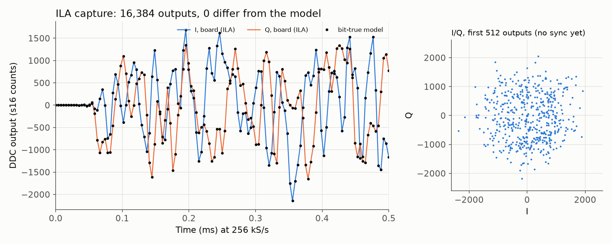](docs/media/2026-11-04_phase-b_ddc-ila-baseband.png)

*The downconverter's output, captured on the running Arty A7 by an integrated logic analyzer (lines), on top of the
Python bit-true model's output for the same input (dots): 16,384 of 16,384 samples identical. The input is a
synthetic OQPSK snippet at 8 dB Eb/N0 in block RAM. On the right, the unsynchronized I/Q: a noisy ring, still
rotating at the 1 kHz residual carrier. Timing and carrier recovery (Phase C) turn it into four clusters. This is a
stand-in hero image: the intended one, a Meteor image decoded by this receiver next to SatDump's, needs a real pass.
`make plots`, from [`ddc_board_ila_iq.csv`](data/results/ddc_board_ila_iq.csv).*

## At a glance

| | |
|---|---|
| **Target signal** | Meteor-M N2-4 LRPT, 72k mode: OQPSK, 72 ksym/s, conv K=7 r½, NRZ-M, CCSDS randomizer, RS(255,223) interleave 4. Parameters read from SatDump 1.2.2's source ([signal-spec.md](docs/signal-spec.md)) |
| **Receive chain** | DDC (NCO + mixer, CIC ÷4, 31-tap droop FIR) → RRC → AGC → Costas + Farrow/Gardner → encoded-ASM frame sync → Viterbi → NRZ-M → derandomizer → RS×4, **all in RTL and all on the board**, fed over 100 Mb/s Ethernet and sending CADUs and stats back. The host computes a coarse carrier estimate and loads it into the NCO ([ADR 0002](docs/decisions/0002-oqpsk-timing.md), [ADR 0014](docs/decisions/0014-control-commands.md)) |
| **Whole receiver on the board** | **15 / 15 replays: 298 CADUs each, every one matching a sent frame** on its 892 data bytes, asked at 1×, 5× and 5.6× real time over Ethernet, synthetic recording (8 dB); no RS correction needed, every datagram placed in order by the ingest's reorder buffer ([board_rx_eth.csv](data/results/board_rx_eth.csv)). 13,682 LUT (21.6%), 100 MHz met, WNS +0.256 ns ([board_arty_rx_eth_top.csv](data/results/board_arty_rx_eth_top.csv)) |
| **Real passes decoded** | 0. Own passes recorded since 2026-11-13, none decoded yet ([MANIFEST](data/MANIFEST.md)) |
| **CADU match vs. SatDump** | Synthetic recording: SatDump decoded 258 / 295 / 226 of 300 frames in three runs, **every decoded frame matching** ([satdump_crosscheck.csv](data/results/satdump_crosscheck.csv)). Real pass: `[TBD]` |
| **DDC on the board** | **16,384 / 16,384 outputs bit-exact** vs. the model, over UART ([ddc_board.csv](data/results/ddc_board.csv)) and again over JTAG/ILA ([ddc_board_ila.csv](data/results/ddc_board_ila.csv)); **fed over Ethernet by `gs-replay`, 38 of 40 replays bit-exact at 1×, 5× and 5.6× real time**; the other 2 arrived with datagrams reordered before the board, as its own counters show ([ddc_board_eth.csv](data/results/ddc_board_eth.csv)); 100 MHz, synthetic input |
| **DDC throughput** | 9.0 clocks per input sample: **10.8× real time** at 100 MHz, RTL simulation ([ddc_rtl_sim.csv](data/results/ddc_rtl_sim.csv)) |
| **Coding gain at BER 10⁻⁵** | Model only, before NRZ-M: 10⁻⁵ at 4.28 dB with 4-bit soft decisions (4.15 dB unquantized) against 9.59 dB for uncoded OQPSK theory, a 5.3 dB gain (5.4 dB unquantized) ([soft_width_ber.csv](data/results/soft_width_ber.csv)). **Hardware, after NRZ-M: 10⁻⁵ at 4.32 dB**, interpolated between the 4.0 and 4.5 dB points, a 5.3 dB gain ([ber_board.csv](data/results/ber_board.csv)) |
| **Viterbi throughput and headroom** | RTL decoder bit-exact with the model, errors included; **96 clocks per bit, 14.5× real time** at 100 MHz, RTL simulation ([viterbi_rtl_sim.csv](data/results/viterbi_rtl_sim.csv)). **Hardware BER before RS: 0.12–0.36 dB from the model** at 2–4.5 dB; after RS, 0 errors from 3 dB up ([ber_board.csv](data/results/ber_board.csv)) |
| **Lock / Doppler** | Bit-true chain (bit-exact with the RTL), from reset at 6 dB with a 30 Hz/s ramp: **locks from −15 to +14 kHz in 16–35 ms** (4× the ±3.4 kHz Doppler); tracks the pass-maximum Doppler rate with **0.84 Hz rms error** ([sync_lock_range.csv](data/results/sync_lock_range.csv), [sync_doppler_track.csv](data/results/sync_doppler_track.csv)). On the board: `[TBD]` |
| **Formal proofs** | Viterbi path metrics: the overflow bound proven unbounded, with the 9-bit modulo metrics proven equal to exact ones mod 512 ([docs/viterbi.md](docs/viterbi.md)). AXI4-Stream handshake rules proven on 17 blocks' boundaries. Frame sync FSM: queue, lock timing, frame spacing and flywheel limit proven. RS syndromes proven against their definition (in fpga-rs-core) |
| **Functional coverage** | **73 / 73 bins hit** (frame sync transitions and slips, each hypothesis, RS corrections 0–16 + uncorrectable, Viterbi metric wrap, backpressure on every interface); loop lock states excluded, no lock detector ([coverage.csv](data/results/coverage.csv)) |
| **Bugs caught** | 31 written up as symptom → root cause → fix ([below](#bugs-found)); planted bugs at every layer, each caught except one equivalent mutant ([list](#bugs-found), counts per campaign in [docs/log.md](docs/log.md)) |
| **Fmax** | DDC out of context **100 MHz met, WNS +0.661 ns**; board build WNS +1.521 ns; RRC +2.453 ns, AGC +2.344 ns, Costas +2.360 ns, timing +1.604 ns, **whole sync chain +1.431 ns**, Viterbi decoder +1.895 ns, frame sync +0.653 ns, **sync chain → RS +0.629 ns** out of context; **whole receiver on the board +0.256 ns** placed and routed ([board_arty_rx_eth_top.csv](data/results/board_arty_rx_eth_top.csv), [synth_ddc_top.csv](data/results/synth_ddc_top.csv), [board_arty_ddc_rom_top.csv](data/results/board_arty_ddc_rom_top.csv), [synth_sync_rrc.csv](data/results/synth_sync_rrc.csv), [synth_sync_agc.csv](data/results/synth_sync_agc.csv), [synth_sync_costas.csv](data/results/synth_sync_costas.csv), [synth_sync_timing.csv](data/results/synth_sync_timing.csv), [synth_sync_top.csv](data/results/synth_sync_top.csv), [synth_fec_viterbi.csv](data/results/synth_fec_viterbi.csv), [synth_fec_framesync.csv](data/results/synth_fec_framesync.csv), [synth_rx_chain.csv](data/results/synth_rx_chain.csv)) |
| **Utilization** | DDC: 1,036 LUT, 1,659 FF, 6 DSP48E1, 1 RAMB18, **1.6% of the LUTs**. RRC: 616 LUT, 1,874 FF, 2 DSP48E1. AGC: 163 LUT, 68 FF, 4 DSP48E1. Costas: 469 LUT, 153 FF, 7 DSP48E1, 1 RAMB18. Timing: 752 LUT, 564 FF, 9 DSP48E1. **Sync chain: 1,998 LUT (3.2%), 2,659 FF, 22 DSP48E1, 1 RAMB18.** Viterbi: 1,621 LUT (2.6%), 694 FF, 1 RAMB36, no DSP. Frame sync: 3,112 LUT (4.9%), 3,066 FF, 4 RAMB36, 1 DSP48E1. In the board build: RS decoder 4,232 LUT, 3 RAMB18; **whole receiver 13,682 LUT (21.6%), 8 RAMB36 + 7 RAMB18, 29 DSP48E1**. Every multiplier in a DSP |
| **Ground station + CI** | C++20 `gs-replay`, `gs-rx` (RS gate, space-packet demux), `gs-diff`, `gs-view`. On the board's output: space packets equal to the golden model's in 3 / 3 replays, 228 equal to SatDump's, 0 unexplained ([board_gs_rx_packets.csv](data/results/board_gs_rx_packets.csv)). `make ci`, run by [GitHub Actions on every push](https://github.com/RodeanAzari/ccsds-meteor-lrpt-receiver/actions/workflows/ci.yml): ruff, mypy, Verilator lint, 179 pytest, 96 cocotb tests (31 builds), 60 GoogleTest (Release and ASan/UBSan) + 2 under TSan, 13 loopback, libFuzzer 30 s × 2 targets, clang-format, clang-tidy, cppcheck |

## Status

| Phase | State | Key result |
|---|---|---|
| 0 — Signal spec + capture kit | **In progress** | [signal-spec.md](docs/signal-spec.md) from SatDump's source; first decodable pass recorded 2026-11-21 (SatDump: 4,583 CADUs, peak SNR 16.5 dB, [MANIFEST](data/MANIFEST.md)); spec not yet confirmed on it |
| A — Python golden model | **In progress** | Float and bit-true chains decode synthetic signals; real recording pending |
| B — Digital downconverter | **Done** (2026-11-07) | Bit-exact on the board from BRAM (UART and ILA) and over Ethernet from `gs-replay` (38 of 40 replays; the other 2 had datagrams reordered on the host side) |
| C — Synchronization | **In progress** | Sync chain RTL bit-exact in simulation; its output decodes. Lock range ±15 kHz, lock in 16–35 ms. Real recording pending |
| D — Viterbi + frame sync | **In progress** | Viterbi decoder and frame sync RTL bit-exact with the model (frame sync window for window in 13 scenarios), and in the chain from DDC output; hardware BER 0.12–0.36 dB from the model ([ber_board.csv](data/results/ber_board.csv)) |
| E — Reed-Solomon + real decode | **In progress** | Stats packets back over Ethernet; RS decoder released as [fpga-rs-core](https://github.com/RodeanAzari/fpga-rs-core) `rs-core-v1.0`; NRZ-M, ASM check, derandomizer and RS in RTL after the Viterbi, bit-exact in simulation; **the whole receiver on the board decodes a replayed synthetic recording, 298 / 298 CADUs in 15 / 15 replays up to 5.6× real time**. A real pass next |
| F — C++ ground station | **In progress** | `gs-replay`, `gs-rx` (RS gate, space packets), `gs-diff`, `gs-view`, fuzzed parsers; board → gs-rx bit-identical to SatDump on all 258 common frames ([board_gs_rx.csv](data/results/board_gs_rx.csv)); space packets from the board equal to the model's and SatDump's ([board_gs_rx_packets.csv](data/results/board_gs_rx_packets.csv)) |

Architecture, ADR summary and clock-domain crossings: [docs/design.md](docs/design.md). Lab notebook with every
measurement and bug: [docs/log.md](docs/log.md).

**Dependencies on other projects:** both gates on the shared Ethernet core are met (`eth-core-v0.1` for streaming
to the board, `eth-core-v0.2` for sending frames back). One request is open with its owner: hold the MAC in reset
until the PHY link is up (see Limitations); a stopgap in this repo covers it meanwhile.

### Shared components

Three blocks come from companion repositories, used only at tagged releases, never copied in. fpga-eth-core and
tb-common are built and released by another project (an FPGA order book); fpga-rs-core is released from this project
and also serves a SerDes project as its KP4 FEC decoder:

| Repository | What it provides here | How it is pinned |
|---|---|---|
| [**fpga-eth-core**](https://github.com/RodeanAzari/fpga-eth-core) | 10/100 MII MAC, CRC-32, async FIFO, IPv4/UDP RX/TX: the link that carries IQ from `gs-replay` to the board and decoded CADUs back | Git submodule at `rtl/eth/`, at `eth-core-v0.2`. RX (`eth_rx` → `udp_rx`) feeds the DDC; TX (`udp_tx` → `eth_tx`) carries the CADU and stats packets back |
| [**tb-common**](https://github.com/RodeanAzari/tb-common) | Shared cocotb helpers: AXI-Stream source and sink with random valid/ready backpressure, an in-order scoreboard, seeded per-test RNG. Every block-level cocotb test in `tb/cocotb/` drives and checks its block through them (the board-top tests drive the MII pins and decode the UART pin themselves) | `pip install` from git at `tb-common-v0.1`, pinned in [`requirements.txt`](requirements.txt) |
| [**fpga-rs-core**](https://github.com/RodeanAzari/fpga-rs-core) | Parameterized Reed-Solomon decoder (riBM, one symbol per clock), verified at CCSDS RS(255,223) and KP4 RS(544,514): the RS stage after the derandomizer, one instance with the ×4 deinterleave around it ([ADR 0012](docs/decisions/0012-rs-instance-count.md)) | Git submodule at `rtl/rs/`, at `rs-core-v1.0` |

## Architecture

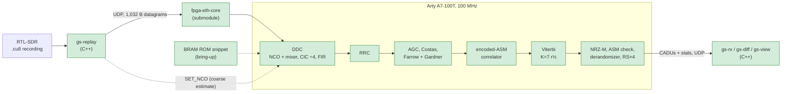

Every block is built, bit-exact against the model in simulation, and running on the board; the BRAM ROM path was the
Phase B bring-up. What is not verified yet is any of it on a real recording.

[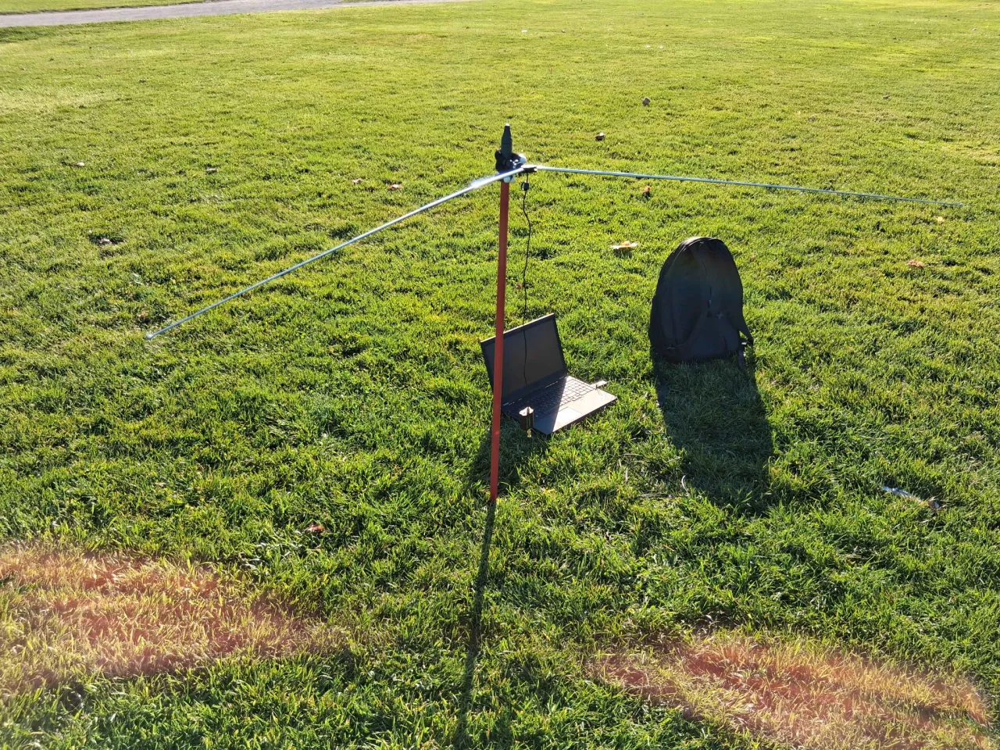](docs/media/2026-11-21_phase-0_antenna-setup.webp)

*The capture side during the 2026-11-21 Meteor-M N2-4 pass, the first one SatDump decoded (4,583 CADUs,
`data/MANIFEST.md`): a V-dipole on a pole in an open field, its feed running to the laptop through the SAWbird+ NOAA
LNA and an RTL-SDR Blog V3, recording at 1.024 MS/s. A photo of the whole
chain, antenna to laptop to Arty over Ethernet, is still to come.*

[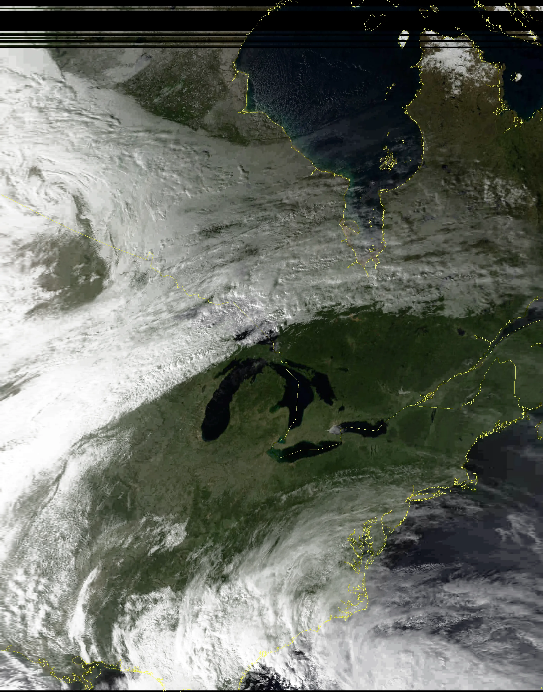](docs/media/2026-11-21_phase-0_satdump-image.webp)

*What that pass carried: SatDump 1.2.2's MSU-MR natural-colour composite (MSA, map overlay) from the 2026-11-21
recording, rotated 180° so north is up (the pass ran south to north). The Great Lakes are in the middle, Hudson Bay at
the top; the striped rows at the top edge are the end of the pass, below 10° elevation. This is SatDump's decode;
the same image out of this receiver is the hero image still to come.*

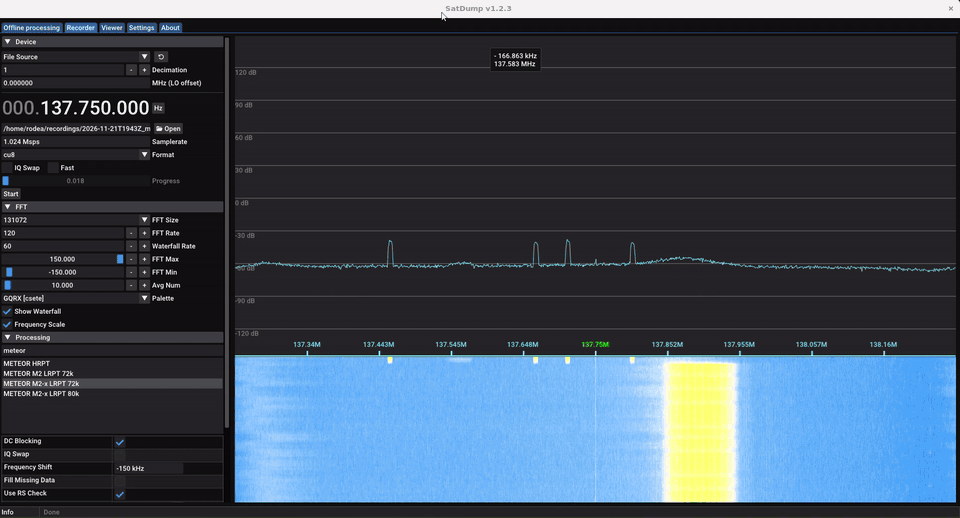

*The same recording replayed through SatDump's recorder at the pass's peak: the Meteor signal is the 120 kHz-wide band
at 137.9 MHz, 150 kHz above the tuning (the line at 137.75 MHz is the dongle's DC spike). Once the 72k pipeline
starts, the OQPSK constellation settles into four clusters and the Viterbi decoder and deframer sync. A still, with
SNR and Reed-Solomon state: [2026-11-21_phase-0_satdump-waterfall.png](docs/media/2026-11-21_phase-0_satdump-waterfall.png).*

- **Clocking:** the datapath is one 100 MHz domain from the MMCM. The DDC needs 9.0 clocks per sample against 97.7
  available at 1.024 MS/s. The one data crossing is the PHY's 25 MHz MII receive clock into the core, through
  fpga-eth-core's Gray-pointer async FIFO; the MAC reset, the buttons and the MMCM lock go through synchronizers.
  Every crossing is listed and constrained ([design.md](docs/design.md), ADR 0011).
- **Interfaces:** AXI4-Stream between every block, with I and Q in one beat (`tdata = {Q, I}`). Every block honours
  backpressure, and pipelines stall as a whole, so nothing is dropped and the rails never skew.
- **Data flow:** raw 8-bit unsigned I/Q at 1.024 MS/s, tuned 150 kHz off the signal to keep the RTL-SDR's DC spike
  out of band; the DDC mixes it to baseband and decimates to 256 kS/s (3.56 samples per symbol).
- **Fixed point:** every signal's width, rounding and saturation is in [fixed-point.md](docs/fixed-point.md), and the
  bit-true model uses exactly the same, so RTL tests compare for equality, not tolerance.
- **Packet formats:** [protocol.md](docs/protocol.md), the single source for the RTL and the C++ tools.

## Verification

Each layer is checked against the layer above it. Nothing is called done until the layer below
reproduces the layer above bit for bit.

**Models** (`make model-test`, pytest, 179 tests including the host-side board scripts):

- The float model is checked against theory: uncoded BER matches Q(√(2Eb/N₀)) at every point from 0 to 8 dB, and
  soft Viterbi sits on the union bound from 3.5 dB up (1.79×10⁻⁵ measured vs. 1.81×10⁻⁵ at 4.0 dB)
  ([ber_awgn.csv](data/results/ber_awgn.csv)). The RS encoder is checked against libcorrect built from SatDump's own
  source, and the codec is also tested as RS(544,514) over GF(2¹⁰).
- **SatDump cross-check:** SatDump 1.2.2 decoded the model's synthetic recording, and every frame it wrote matches
  the truth. So our transmitter and SatDump's receiver agree without anyone having to trust this repo's receiver.
- The bit-true model (DDC, RRC, AGC, Costas, Farrow, Gardner, Viterbi) decodes the same frames as the float model at
  every tested point, which is what lets RTL tests use exact comparison.

**cocotb on Verilator** (`make sim` + `make sim-slow`, 96 tests in 31 builds): each DDC block and the whole chain, bit-exact against
`model/ddc_fixed.py` on a modulated OQPSK signal with a Doppler ramp and DC offset, **under random input gaps and
output stalls**. Each sync block (RRC, AGC, Costas, Farrow/Gardner timing) is bit-exact against
`model/rrc_fixed.py` / `model/sync_fixed.py` the same way, with the loops driven through pull-in and their clamps. `sync_top` chains them and is bit-exact against the model
chain with the output slower than the chain, so stalls reach every inner link. `make sim-full` runs the chain from
reset on three frames and decodes its output through the model's back end (frame sync, Viterbi, RS), and runs the
chain through the RTL frame sync and Viterbi on five frames, every output bit checked. The Viterbi
blocks are checked the same way: the branch metrics on all 256 input pairs, the ACS on every difference around the
signed wrap, and the 64-state array, traceback and whole decoder bit-exact against `model/viterbi_fixed.py`. The back end (`fec_frame_extract`, `fec_cadu` with RS in both write-back modes), the Ethernet ingest with its reorder
buffer (three depths), the command and packet blocks, and both board tops are tested the same way; the receiver
top is driven through its MII pins at line rate and every CADU packet it sends is checked against the model.
**Functional coverage** (`make cov`, Verilator `--coverage-user` over every suite): the bins of buildplan §8.2 are
cover properties next to the RTL ([docs/coverage.md](docs/coverage.md)). The frame sync's transitions are covered,
along with slips at −2..+2, each of 4 hypotheses winning, every RS correction count 0–16 and an uncorrectable
codeword, the Viterbi metric wrap, and a stall on both sides of every streaming block. **All 73 bins are hit**, and
one group (loop lock states) is excluded with a reason, since there is no loop lock detector
([coverage.csv](data/results/coverage.csv)). Closing it took two new scenarios and one new block test.

**On the hardware:** the Phase B top plays a 65,536-sample synthetic snippet from BRAM through the DDC at full
speed. All 16,384 outputs are checked two ways: a CRC-protected UART dump (`make board-check`), and an ILA capture
over JTAG, storage-qualified on the output handshake so the whole output fits in the buffer (`make ila-capture`).
Both match the model with 0 mismatches. A script checks the ILA capture, which also proves the trigger alignment
and probe bit order. The receiver top is checked by scripts that replay a recording, then compare every CADU with
the truth (`make rx-check`), with SatDump (`scripts/board_gs_rx.py`), or count bit errors (`scripts/ber_board.py`);
each replay records the board's own counters.

**Ground station** (`make gs-test`, GoogleTest + pytest loopback): every parser on frames captured from the RTL,
the demultiplexer against the golden model's vectors, the lock-free ring under TSan, and gs-rx end to end on
loopback. Both parsers are fuzzed (libFuzzer, 30 s per target in CI, 30 min weekly).

**Formal** (`make formal`, SymbiYosys): the Viterbi's modulo path metrics. The bound (any two metrics within 180,
so every modulo compare is exact) is SVA in `fec_acs_array.sv`, checked in every simulation. Proven, unbounded: the bound
holds in every reachable state, and the modulo metrics equal exact ones mod 512. Plain k-induction had not finished
after 6.5 hours. Ghost state (an exact copy of the metrics, plus each coset's best metric 1–6 steps back) makes the
bound 1-step inductive, split into 9 tasks that run in 14 minutes. A separate task proves a stall changes no metric
([docs/viterbi.md](docs/viterbi.md), ADR 0006).
AXI4-Stream handshakes (`tb/formal/axis.sby`, 9 minutes): on 17 blocks, from the DDC ingest to the packet
arbiter, an offered beat is never withdrawn or changed before it is taken, and no output is valid right after reset,
given the same of each input. Proven unbounded, by k-induction or, for `fec_frame_extract`, PDR. That block needs a
model of its environment: its flags come from a tap on the Viterbi's input, so its output may not run ahead of that
tap. Not covered: `sync_rrc` (it is `ddc_comp_fir` with 57 taps, and the 31-tap proof stands for its logic) and
`fec_cadu` (the RS decoder inside).
The frame sync FSM (`tb/formal/fec_fs_fsm.sby`, at FRAME = 16), proven unbounded:
- every queued peak is verified at its due position, and the queue never overflows;
- in lock, no expected ASM goes unjudged;
- consecutive locked frames are FRAME ± 2 symbols apart;
- at most `flywheel` flywheel frames in a row;
- a confirm's two frames are FRAME apart.
A cover task reaches lock, a slip, loss of lock, a dropped peak and an early frame, so none of this holds vacuously.
The RS syndrome block is proven in [fpga-rs-core](https://github.com/RodeanAzari/fpga-rs-core) against the syndrome definition, for every
symbol sequence and handshake interleaving, at three small parameter sets, among them a shortened code with the
CCSDS structure (FCR and PRIM ≠ 1); its `make formal` takes 76 s. Every formal item of buildplan §8.3 is done.

### Bugs found

Each one is written up as symptom → root cause → fix in [docs/log.md](docs/log.md).

| # | Bug | Caught by |
|---|---|---|
| 1 | The architecture had no NRZ-M decoder, so no ASM would ever have matched. SatDump's pipeline uses one (ADR 0001) | Reading SatDump's source (Phase 0) |
| 2 | Sync threshold 0.55 sat inside the random-data correlation range (≈ 0.6–0.7), so the receiver locked a wrong phase and the flywheel held it | Model test: Q-leading signal gave 0 frames |
| 3 | After a cycle slip, frame search restarted inside the flywheel window and re-found emitted frames: 223 out of 200 sent | Model frame counting |
| 4 | The SatDump cross-check script sliced a (frames, 1024) array as a flat byte stream and reported 0 of 258 matching | Manual check disagreed |
| 5 | CIC integrators, combs, rounding and saturation in one cycle: missed 100 MHz by 3.262 ns | Vivado out-of-context timing |
| 6 | DC-block accumulator fed straight from BRAM: board build missed by 0.155 ns | Vivado board timing |
| 7 | 16,169 of 16,384 "DDC errors" on the board. The DDC was right: opening the serial port resets the design, and the host read a cut-off dump into the next one. Fixed with a CRC-32 trailer | Board run |
| 8 | `capture_dump` would have sent each word's predecessor (BRAM read one cycle early) | Review, before simulation |
| 9 | The default NCO word was written as `0x0258_0000` instead of `0x2580_0000` (150 kHz) | Review, before simulation |
| 10 | The "before" spectrum showed a notch at DC instead of the DC offset: Welch detrending | Plot review |
| 11 | The DC-step test settled for only 2.9 time constants, so it read 496 instead of 510 (a test bug; the RTL matched throughout) | cocotb |
| 12 | The Farrow test asserted ≤ 1 LSB error; the derived bound for its four roundings is 1.25 LSB (a test bug) | Model test |
| 13 | `fixed-point.md` said the AGC settles near gain 4; measured 5.9–9.8 | Measurement vs. doc |
| 14 | Vivado deletes the `.mem` copies in its run directory at exit, and the ROM was generated there | Second Vivado run in the same directory |
| 15 | Synthesis absorbed and renamed `bb_tready`, so ILA insertion by net name failed. The ILA now probes the equivalent `full` flag, and the build fails loudly on any rename | ILA build |
| 16 | The timing lock test had a 100 ppm clock error, which drifted the half-symbol offset to ~0.05 symbol over the run, so a dead loop would have passed too (a test bug). The test's no-loop baseline guard failed; the lock run now has no clock error | cocotb baseline guard |
| 17 | The first `sync_top` test, with the output ready half the time, never stalled the inner links: an AGC wired to ignore the Costas loop's `tready` passed it (a test bug). Output ready 0.8% of the time, slower than the chain, makes stalls reach every stage | Planted bug |
| 18 | After the timing block changed, the slow-sink chain test lost its last 2 outputs: the harness waited 200 clocks after the input ended, at ~125 clocks per output. The drain window now scales with the sink's ready rate (a test bug; 6,748 outputs had matched) | cocotb |
| 19 | Frame-sync ring: windows overlap by 320 symbols, so the next window can start before the reader's position, and the input overwrote its first symbols while the reader finished the previous one | SVA `a_read_in_ring` in simulation |
| 20 | Frame sync missed 100 MHz by 1.867 ns (threshold multiply → FSM → descriptor FIFO in one clock), then by 0.916 ns (`s_tready` in a loop through the FSM). The hit flags and `s_tready` are now registers | Vivado out-of-context timing |
| 21 | The path-metric k-induction failed in 40 s on a run of stalls: k steps of induction can be one unreachable state held still. The bound proof now steps every clock, and a separate task proves a stall changes no metric | SymbiYosys counterexample |
| 22 | The Ethernet ingest deadlocked when a datagram was one byte too long and the ring was full: the byte carrying `tlast` waited for room that never came. Only bytes that write a sample wait now | cocotb (DEPTH 512 only) |
| 23 | No dump on a second Ethernet replay: opening the serial port did not reset the design this time (compare bug 7). `eth-check` reprograms the FPGA before each replay | Board run |
| 24 | DDC dumps wrong with every sample present: whole datagrams reordered on the host, reproduced exactly by feeding the model the same order. The receiver's ingest now has a reorder buffer (ADR 0013) | Board run + model |
| 25 | Replays dying with absurd counters (FIFO high-water 4,095 of 2,048): fpga-eth-core's RX FIFO comes up corrupted when the PHY link is slow to come up. Reported to its owner; a MAC-restart stopgap here, which fired on hardware once | Board stats counters |
| 26 | `stats_packet` drove TVALID during reset | cocotb (second run after a reset) |
| 27 | The MAC-restart stopgap counted one event twice (its reset request lags a cycle) | cocotb |
| 28 | The `gs-replay` pacing test failed 1 run in 5 under load: it timed arrivals at thread wake-up, and loopback itself reorders under load (a test bug) | Repeated runs under load |
| 29 | `gs-view` tests matched "-nan" as "-": a NaN rate would have passed (a test bug) | Planted bug |
| 30 | `gs-rx` never stopped on `--idle` with a board attached: the stats packet every 100 ms reset its idle timer | First board run |
| 31 | Replay datagrams lost at 5× and 5.6×: the host kernel drops them at the USB-Ethernet adapter under load (`tx_dropped` equals the board's `ingest_lost`). Now recorded per replay | Board counters vs. host counters |

**Planted bugs, each caught:**
- DDC: DC accumulator 4 bits short; a sign error in one NCO quadrant; CIC registers one bit short (caught only by
  the full-scale test, since 21 bits suffice at the mixer's real signal level); the FIR dropping its last tap.
- Sync: AGC target doubled; Costas integrator without fraction bits; a Farrow coefficient sign.
- Sync RTL: Costas phase updated with the previous sample's frequency; Costas sgn(0) taken as +1; Costas upper
  frequency clamp removed; Gardner detector always on the I rail; timing integrator clamp removed (caught only by
  the clamp test); each of the three inner `tready` links in `sync_top` tied high (caught only by the chain test, once
  its output was made slower than the chain: with the output ready half the time, the first of these passed).
- Viterbi RTL: unsigned compare on wrapped path metrics; ties to branch 1; a branch metric with the wrong expected
  bit; a branch metric losing its carry; wrong predecessor wiring; the ACS array ignoring an output stall (caught only
  by the backpressure runs); the traceback one row short, starting a row early, first bit a row late, shifting the
  state the wrong way, or accepting rows mid-walk; the ACS array ignoring the traceback's stall.
- Frame-sync RTL (21 of 22 caught, after three test fixes): ring guard ignoring the next window; no FIFO-space
  check; ring margin dropped; alternate inverting G1; swap ignored; `tlast`
  a pair early; the second symbol read twice; slip search +1 before −1 (needed a constructed −1/+1 tie); flywheel off
  by one; verify on any hypothesis; queue one short; queue kept on lock; early-frame boundary off by one (needed a
  frame exactly at the boundary); hit history reversed; a d = 0 slip uncounted; threshold `>=`; a correlator or level
  tap misaligned; the FSM a position early; quantizer wrapping; I/Q rails swapped. Not caught, and equivalent: FIFO
  space computed without this clock's pushes, since pushes are always about a frame apart.
- Viterbi: plain comparison on wrapped path metrics; quantizer offset by one; traceback one step off; the
  best-state start ignored.
- Board: the capture buffer's stale-read bug put back; the ILA parser with I and Q swapped.
- `gs-replay`: sequence number written little-endian; pacing removed; pacing skipped, speed doubled, speed ignored.
- Formal: no metric reset; 8-bit metrics at 4-bit soft (bounded check). Against the unbounded proof: no metric
  reset, a sign-extended branch metric (which the 8-step bounded check could not reach), an ACS keeping the larger
  candidate, and a branch metric above BM_MAX. AXI-Stream: a valid dropped without ready, input accepted under
  a stalled output, and an unreset valid (`ddc_cic`); an ungranted valid (`pkt_arb2`); a rail select stepping
  without ready (`fec_soft_quant`); body bytes taken while the output is stalled (`cadu_packet`). Frame sync
  FSM: a peak due one late, the full-queue check off by one, a lock judging one late, loss of lock one miss late, and
  a confirm's second frame one symbol off.
- RS ([fpga-rs-core](https://github.com/RodeanAzari/fpga-rs-core)): 24 across the model and the RTL.
- Ethernet ingest, command and board tops: 6 in the ingest, 3 in the DDC Ethernet top (one, a reset tied off, only
  after the test replays across a reset); 6 in `ctrl_rx`, 3 more in the ingest and 3 in the receiver top for
  SET_NCO; `cadus_sent` counting stats packets; the NCO word negated.
- Ground station: 5 in the board-packet parser (one, an uncapped field count, also found by the fuzzer within
  30 s); 7 in the demultiplexer (the 5-bit VCID mask only after a VCID-37 stream was added); 4 in the ring (two
  memory-ordering bugs caught only by TSan); 3 in gs-rx's processing; 10 in gs-diff; 15 in `packet_diff` (one
  after a test was added; one survivor, reachable only with fabricated data); 15 in gs-view; 2 for `--idle`; 7 in
  the space-packet recording generator and the hardware packet check.

## Digital downconverter

Mixes the signal from its 150 kHz tuning offset to baseband and decimates 1.024 MS/s → 256 kS/s:
`ddc_ingest` (cu8 → signed, DC block pipelined over three stages) → `ddc_nco_mixer` → `ddc_cic` → `ddc_comp_fir`.

| Choice | Options considered | Chosen | Evidence |
|---|---|---|---|
| NCO ([ADR 0003](docs/decisions/0003-nco.md)) | Quarter-wave table; full-wave table; 16-stage CORDIC; table + dither | 32-bit phase accumulator, 12-bit quarter-wave table of s16, half-step offset so quadrants mirror cleanly | SFDR 71.6–72.8 dB over 64 random tuning words, matching the ≈ 72 dB 12-bit estimate ([ddc_nco_sfdr.csv](data/results/ddc_nco_sfdr.csv)) |
| Decimation ([ADR 0004](docs/decisions/0004-cic.md)) | CIC order 3 + droop FIR; polyphase FIR alone; CIC order 4–5; two half-bands | CIC ÷4, order 3, 22-bit registers, then a 31-tap droop FIR with one time-shared multiplier per rail | Bit-true DDC SQNR 51–54 dB; same frames and soft SNR as the float DDC ([ddc_fixed_chain.csv](data/results/ddc_fixed_chain.csv)) |

**Cost, out of context at 100 MHz** ([synth_ddc_top.csv](data/results/synth_ddc_top.csv)):

| Block | LUT | FF | DSP48E1 | RAMB18 |
|---|---|---|---|---|
| `ddc_ingest` | 185 | 86 | 0 | 0 |
| `ddc_nco_mixer` | 196 | 106 | 4 | 1 |
| `ddc_cic` | 279 | 434 | 0 | 0 |
| `ddc_comp_fir` | 379 | 1,033 | 2 | 0 |
| **`ddc_top`** | **1,036** | **1,659** | **6** | **1** |

WNS +0.661 ns, WHS +0.112 ns. The FIR's flip-flops are mostly its 31-sample history on both rails, which is cheap
to move into SRLs if area ever matters.

**Verified by:** bit-exact cocotb tests per block and for the chain under backpressure; four planted bugs; and on the
board, two independent readouts, both bit-exact.


*Left: the cu8 snippet in BRAM, signal at +151 kHz with a DC offset. Right: the board's DDC output at 256 kS/s,
signal at +1 kHz (the residual left for the Costas loop), DC removed. From
[ddc_board_spectrum.csv](data/results/ddc_board_spectrum.csv).*

## Timing and carrier recovery

The design was made in the bit-true model, and the RTL matches it bit for bit. The OQPSK stagger is the hard part: Q is offset by half a
symbol, so a plain QPSK timing detector sees the Q rail at the wrong instants.

| Loop order ([ADR 0002](docs/decisions/0002-oqpsk-timing.md)) | Frames of 48 at 0 / 300 / 1,000 / 3,000 Hz offset |
|---|---|
| **Costas first, then per-rail Gardner at 2 sps** | **48 / 48 / 48 / 48** |
| Per-rail Gardner first, then Costas | 9 / 48 / 16 / 42 |
| Plain QPSK Gardner first | 0 / 0 / 0 / 0 |

([sync_loop_order.csv](data/results/sync_loop_order.csv)) A per-rail detector running on an unresolved carrier sees
the other rail half a symbol off, which scales its error by cos 2θ, so it averages to zero while the carrier rotates.

- **Acquisition:** a Costas loop narrow enough to track well doesn't pull in from 2–3.4 kHz within 3.4 s
  ([sync_pull_in.csv](data/results/sync_pull_in.csv)). So a coarse estimate from the fourth-power spectral line
  comes first, computed on the host and loaded into the DDC's NCO word. That way there's no FFT hardware, and the RRC
  sees a centred signal.
- **Chosen:** Costas 0.001 rad/sample; Farrow cubic to 2 sps; per-rail Gardner, kp 0.02; AGC on I²+Q² power.
- **Measured (model):** at 3.4 kHz with a 30 Hz/s ramp, the bit-true chain decodes the same frames as float from 2
  to 8 dB, and tracks frequency with 1.7–4.0 Hz rms error. AGC settles in 60–104 ms
  ([sync_fixed_chain.csv](data/results/sync_fixed_chain.csv), [sync_agc_settle.csv](data/results/sync_agc_settle.csv)).
- **RTL so far:** the RRC (`rtl/sync/sync_rrc.sv`) reuses the DDC's time-shared FIR with the 57 RRC taps, since the
  arithmetic is identical. 4,000 / 4,000 outputs bit-exact against the model under random backpressure, 62 clocks per
  sample (6.3× real time), WNS +2.453 ns at 100 MHz out of context ([rrc_rtl_sim.csv](data/results/rrc_rtl_sim.csv),
  [synth_sync_rrc.csv](data/results/synth_sync_rrc.csv)).
- **AGC RTL:** `rtl/sync/sync_agc.sv`, one sample at a time through a 5-stage pipeline so each gain update lands
  before the next sample (the model's loop is per sample). 16,500 outputs bit-exact against the model, including a
  full-scale burst that overflows s16; 6 clocks per sample (65× real time); WNS +2.344 ns, 4 DSP48E1
  ([agc_rtl_sim.csv](data/results/agc_rtl_sim.csv), [synth_sync_agc.csv](data/results/synth_sync_agc.csv)). The
  gain step has a dead zone of ±25% in power, so on a constant-envelope input the AGC settles anywhere in 0.87–1.12
  of the target rms; noise dithers it on real signals ([fixed-point.md](docs/fixed-point.md)).
- **Costas RTL:** `rtl/sync/sync_costas.sv`, one sample in flight like the AGC, reading its own copy of the DDC's
  sine table. 26,000 outputs bit-exact against the model: a 50 Hz post-coarse residual with a 30 Hz/s ramp, which the
  loop pulls in within the run (ends at 52.0 Hz), and a run held at a 20 Hz frequency clamp. 10 clocks per sample
  (39× real time); WNS +2.360 ns after splitting the phase detector over two stages (it was +0.512 ns in one)
  ([costas_rtl_sim.csv](data/results/costas_rtl_sim.csv), [synth_sync_costas.csv](data/results/synth_sync_costas.csv)).
- **Farrow/Gardner RTL:** `rtl/sync/sync_timing.sv`. Each output's Gardner error sets the next position, so outputs
  are produced one at a time: fill a 4-sample window, three Horner steps per rail, the detector on the rail the
  output belongs to, then the PI update. 14,619 outputs bit-exact against the model: an input starting half a symbol
  late, where the strobe eye ratio (mean/std of |soft|) ends at 2.08 against 1.48 with the loop off, and a 100 ppm run
  with the integrator limit at one ki step. 9.42 clocks per input sample (41× real time). Two stages were split for
  timing: the output saturation (+0.583 → +0.745 ns alone), then the cubic's coefficients, which were the chain's
  worst path at +0.525 ns (→ +1.604 ns alone, +1.431 ns in the chain)
  ([timing_rtl_sim.csv](data/results/timing_rtl_sim.csv), [synth_sync_timing.csv](data/results/synth_sync_timing.csv)).
- **Sync chain:** `rtl/sync/sync_top.sv`, the four blocks on AXI-Stream. Bit-exact against the model chain on the
  bit-true DDC output of a 1 kHz + 30 Hz/s, 0.37-symbol, 20 ppm input, from reset. 62 clocks per sample (the RRC sets
  it), 6.3× real time. From reset on three frames (87,388 samples, 49,156 outputs, all bit-exact), its soft symbols
  decode through the model's back end to **1 CADU, matching a sent frame, 0 wrong**: the first frames out of RTL.
  1,998 LUT, 22 DSP48E1, 1 RAMB18, WNS +1.431 ns ([sync_top_rtl_sim.csv](data/results/sync_top_rtl_sim.csv),
  [sync_chain_rtl_decode.csv](data/results/sync_chain_rtl_decode.csv), [synth_sync_top.csv](data/results/synth_sync_top.csv)).
- **Lock time and range:** measured on the bit-true chain, which the RTL matches bit for bit, from reset at 6 dB
  with a 30 Hz/s ramp. With the host's coarse estimate, **every offset from −15 to +14 kHz locks in 16–35 ms**;
  +16 and −20 kHz don't, because they fall outside the estimator's search window (±`costas_max_hz`, 15 kHz). The
  estimate leaves 12–18 Hz, which is the ramp across its 1 s window. On its own, the Costas loop locks within one
  frame (114 ms) up to about ±100 Hz of error. At 150 Hz it takes 238–314 ms. At 300 Hz it took 0.9–1.2 s, and one
  seed in four never locked within the 1.37 s run
  ([sync_lock_range.csv](data/results/sync_lock_range.csv), [sync_lock_costas.csv](data/results/sync_lock_costas.csv)).
- **Doppler tracking:** through closest approach, falling at 30 Hz/s through zero, the carrier estimate (NCO plus
  the Costas register) is 0.84 Hz rms off after the first 0.1 s, 3.0 Hz at most, and 38 of 40 frames decode
  ([sync_doppler_track.csv](data/results/sync_doppler_track.csv)). The run covers the steepest 4.6 s, not a whole
  pass.

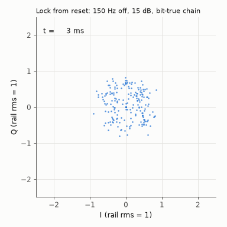

*Carrier lock from reset on the bit-true chain (identical to the RTL's output), 150 Hz off the carrier at 15 dB:
the constellation spins as a ring, then settles into four clusters. `make plots`.*

| Lock time vs. carrier error | Doppler tracking at 30 Hz/s |
|---|---|
| [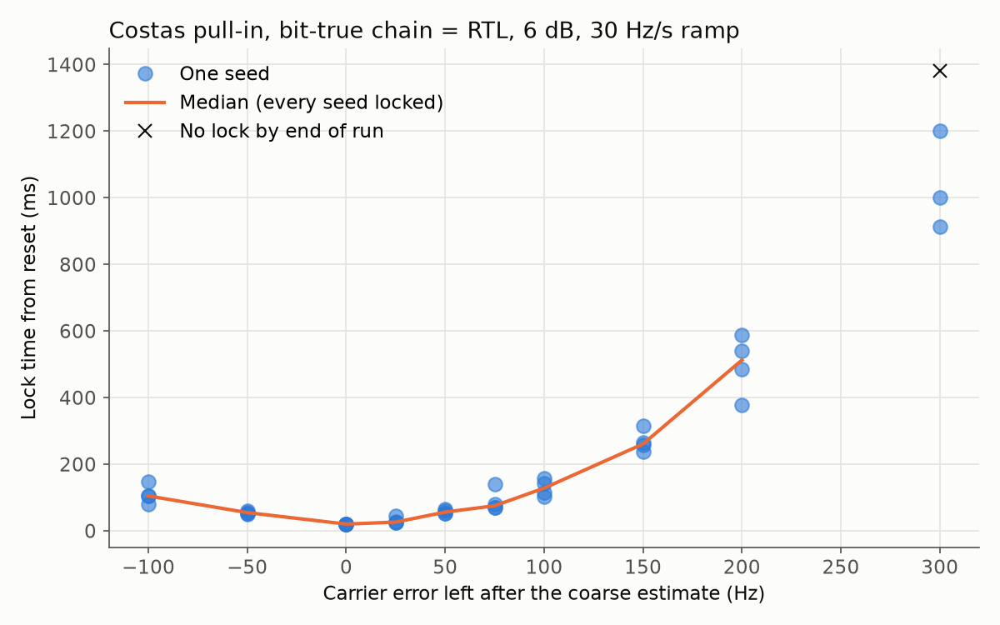](docs/media/2026-11-05_phase-c_lock-time.png) | [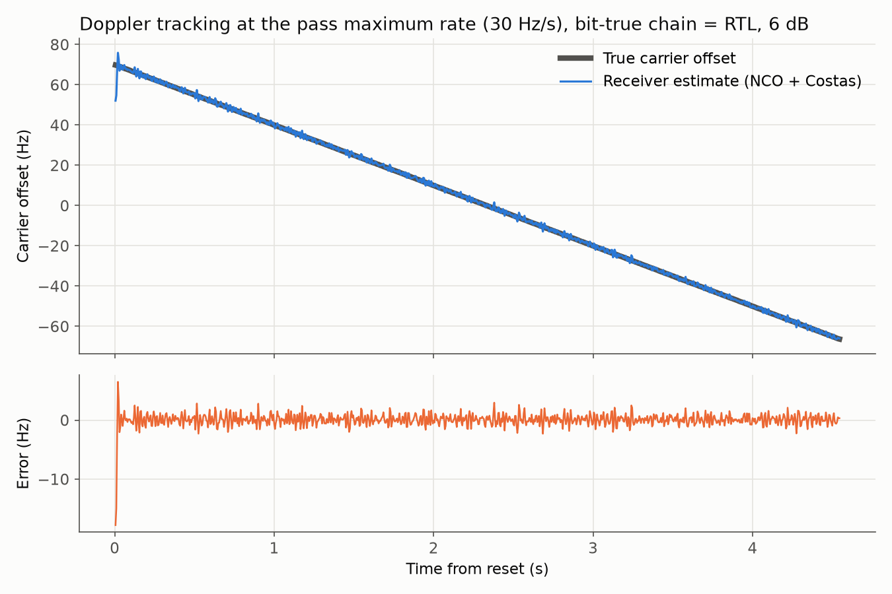](docs/media/2026-11-05_phase-c_doppler-tracking.png) |

## Frame sync and phase ambiguity

The ASM `0x1ACFFC1D` is convolutionally encoded with the data, so the receiver correlates soft symbols against the
*encoded* pattern, skipping its first 12 symbols because they depend on the previous frame. Because of NRZ-M
([ADR 0001](docs/decisions/0001-nrzm-decoder.md)), a 180° rotation is irrelevant, so the search covers
{0°, 90°} × I/Q swap on the absolute correlation. The winner gives both the frame position and the derotation.
SEARCH → VERIFY → LOCK with a flywheel; threshold 0.75, chosen after bugs 2 and 3 above.

**RTL** (`rtl/fec/`, [ADR 0010](docs/decisions/0010-streaming-frame-sync.md)): hardware sees each symbol once, so
the RTL matches a causal, bit-true model (`model/framesync_fixed.py`) that finds at least the float model's frames.
`fec_soft_quant` turns the sync chain's `{Q, I}` into the 4-bit serial stream. `fec_fs_correlator` runs four 52-tap
correlators plus Σ|v| in transposed form (one small add per register) and thresholds |c|·64 > 48·Σ|v|.
`fec_fs_fsm` is SEARCH → VERIFY (4-deep queue) → LOCK, with a flywheel and slips followed within ±2 symbols.
`fec_fs_window` writes every symbol into a 32,768-symbol ring and sends each frame to the Viterbi as its own derotated
window, 128 symbols before the frame to 192 after. The window flushes the frame's last bit out of the traceback, and
overlapping windows survive a −1 or −2 slip.

It matches the model window for window, pair for pair, flags and counters included, in 13 scenarios: all four
hypotheses, a missed ASM, lock lost and found again, carrier and timing slips (−1, +2 and a −1/+1 tie), noise, a
full verify queue, and a sink slow enough to stall the input at the ring
([framesync_rtl_sim.csv](data/results/framesync_rtl_sim.csv)). A 128k-ring build also stalls it at the descriptor
FIFO. Out of context it meets 100 MHz with WNS +0.653 ns
and uses 3,112 LUT, 3,066 FF, 4 RAMB36 and 1 DSP48E1 ([synth_fec_framesync.csv](data/results/synth_fec_framesync.csv)).
The FSM is proven formally (`make formal`, `tb/formal/fec_fs_fsm.sby`, at FRAME = 16):
- the verify queue never overflows and verifies every peak when it comes due;
- no lock judgment is skipped;
- locked frames are FRAME ± 2 apart;
- no more than `flywheel` flywheel frames run in a row.

Its invariants are SVA in `fec_fs_fsm.sv`, so Verilator also checks them in every simulation.

## Viterbi decoder

64 states, fully parallel ACS. Decisions from the model, each with its ADR.

| Decision | Options | Chosen | Evidence |
|---|---|---|---|
| Soft width ([0005](docs/decisions/0005-soft-decision-width.md)) | 3-bit, 4-bit | **4-bit**, step 1/4 of rail rms | At BER 10⁻⁵: unquantized 4.15 dB, 4-bit 4.28 dB (0.13 dB loss), 3-bit 4.39 dB (0.24 dB) ([soft_width_ber.csv](data/results/soft_width_ber.csv)) |
| Path metrics ([0006](docs/decisions/0006-path-metric-normalization.md)) | Modulo; subtract-minimum; subtract-on-threshold | **Modulo, 9 bits** | Candidate spread ≤ 7·BMmax = 210 < 256; largest spread seen 104 |
| Survivors ([0007](docs/decisions/0007-survivor-memory.md)) | BRAM + per-bit traceback; BRAM + chunked; register exchange (6,144 FF + 6,144 mux at D = 96) | **BRAM, per-bit traceback** | Bit-exact model of the scheme |
| Traceback depth ([0008](docs/decisions/0008-traceback-depth.md)) | Best-state start at 36–60; state-0 start at 48–96 | **96 from state 0** | +0.1% BER vs. full-block at 2.5 dB, equal at 3 and 4 dB; no 64-way minimum tree ([traceback_depth.csv](data/results/traceback_depth.csv)) |

Depth 96 is outside the build plan's 35–50 guideline ([buildplan.md §3.6](docs/buildplan.md)). That range assumes a best-state start, and even then it measures
2–5% worse than full-block decoding at 2.5–3 dB. ADR 0008 explains the choice.


**RTL** (`rtl/fec/`), built in the order the build plan sets, each step bit-exact against `model/viterbi_fixed.py`
before the next:
- **Branch metrics and one ACS** (`fec_bm`, `fec_acs`): all 256 symbol pairs; random metrics plus every candidate
  difference around 0 and ±256 from every base, so each modulo wrap is crossed. Branch 1 wins when m1 − m0 is
  negative as a 9-bit signed number, and ties keep branch 0, as in the model.
- **64-state array** (`fec_acs_array`): one step per clock, the trellis computed from the G1/G2 taps (no table).
  Every decision row matches over 4,000 steps at 0 dB (the metrics proven to wrap at least 51 times), at 6 dB, and
  on full-scale input with 5% of symbols flipped, which gives the widest metric spread seen, 120 (the bound is 180).
  1,546 LUT, no DSP, WNS +1.552 ns ([synth_fec_acs_array.csv](data/results/synth_fec_acs_array.csv)).
- **Traceback** (`fec_traceback`): a 256 × 64-bit ring in one RAMB36. For each row it walks back `depth` rows from
  state 0, one read per clock, then outputs a bit: depth + 3 clocks per bit. The depth is a register, tested at 96
  and 35. 77 LUT, WNS +4.040 ns; the worst path is the BRAM read into the 64:1 state select
  ([synth_fec_traceback.csv](data/results/synth_fec_traceback.csv)).
- **Decoder** (`fec_viterbi`): at 1.5 dB under random gaps and stalls, it makes 93 bit errors in 3,904, **the
  same bits as the model**, so a hardware BER campaign measures the model's curve. 96 clocks per bit: **14.5× real
  time** at 100 MHz. 1,621 LUT (2.6%), 1 RAMB36, WNS +1.895 ns
  ([viterbi_rtl_sim.csv](data/results/viterbi_rtl_sim.csv), [synth_fec_viterbi.csv](data/results/synth_fec_viterbi.csv)).

**In the chain** (`rtl/top/rx_chain.sv`: `sync_top` → `fec_soft_quant` → `fec_framesync` → `fec_viterbi` →
`fec_frame_extract` → `fec_cadu`), the decoder runs the windows back to back without a reset, so each starts from the
metrics the last one left; the 128-symbol run-in absorbs that (`framesync_fixed.decode_windows()`). From a cold start
on seven synthetic frames, five CADUs come out, every one of their 5,120 bytes and status words equal to the model
chain, each a frame that was sent (RS: nothing to correct at 6 dB). The sink is held until stalls reach the chain's
input, so every inner link stalls ([rx_chain_rtl_decode.csv](data/results/rx_chain_rtl_decode.csv)). Out of context:
11,247 LUT (17.7%), 23 DSP48E1, 5 RAMB36 + 4 RAMB18, 100 MHz with WNS +0.629 ns
([synth_rx_chain.csv](data/results/synth_rx_chain.csv)).

The tradeoffs, with the 3-bit build's area (256 LUTs fewer for 0.11 dB), are in [docs/viterbi.md](docs/viterbi.md).

**On the board** (`scripts/ber_board.py`), synthetic AWGN recordings at 2–5 dB went through the whole receiver: two
builds, one with RS write-back off to see the bits before RS. Each point has ≥ 100 errors, otherwise the plot shows its
95% upper bound. Before RS the board is **0.12–0.36 dB from the model**, most at 2 dB, where the loops are noisiest.
From 3.5 dB up it is close to the 0.13 dB that 4-bit soft decisions alone cost. After RS: 1.3×10⁻³ at 2 dB, 9.6×10⁻⁵ at
2.5 dB, and **0 errors in 42.5 M data bits at each point from 3 dB up** (< 7.0×10⁻⁸, 95%). Every usable frame came
back at every point ([ber_board.csv](data/results/ber_board.csv)).

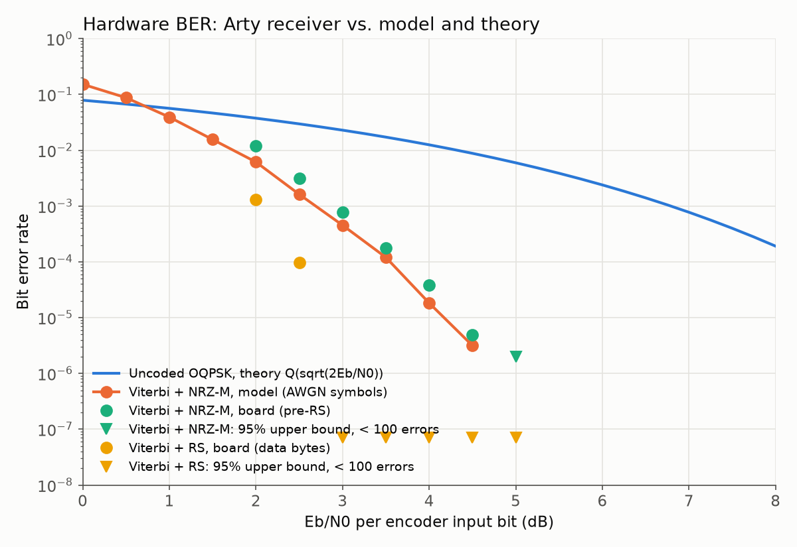

Not yet: BER on a real recording's impairments.

## Reed-Solomon

RS(255,223) over GF(2⁸), field polynomial 0x187, generator roots α^(11j) for j = 112…143, interleave depth 4,
conventional basis (`rs_dualbasis: false` in SatDump's pipeline). The Python codec is parameterized and tested at
both CCSDS and KP4 RS(544,514)/GF(2¹⁰) parameters, because the RTL decoder is shared with another project.

**RTL:** [fpga-rs-core](https://github.com/RodeanAzari/fpga-rs-core) at `rs-core-v1.0` (submodule `rtl/rs/`):
syndromes → riBM → Chien + Forney → output, one symbol per clock, verified at both parameter sets against an
independent reference (reedsolo); 100 MHz out of context, 4,142 LUT and 1.5 RAMB36 at CCSDS. Here it sits in
`fec_cadu` ([ADR 0012](docs/decisions/0012-rs-instance-count.md)): one instance, fed codeword by codeword from a
1 KB buffer that holds the derandomized body and takes the corrections back in place. Each CADU leaves with its
status (phase hypothesis, flywheel, ASM bit errors, per-codeword corrections or fail): the type 2 packet in
[docs/protocol.md](docs/protocol.md).

## Ground station

`gs-replay` (C++20, `gs/`) streams a recording to the board ([ADR 0009](docs/decisions/0009-iq-transport-format.md)).

| Datagram option | Wire efficiency | Max speed on 100 Mb/s | Chosen |
|---|---|---|---|
| **8-byte BE sequence + 512 raw cu8 samples (1,032 B)** | 94.0% | 5.69× real time | **Yes**: power-of-two sample count, matches the Ethernet core's test harness byte for byte |
| 8-byte sequence + 728 samples (fills a frame) | 95.7% | 5.81× | Awkward index math for 0.1× |
| Samples converted to 16-bit on the host | 47% | — | Doubles the bytes, and alters the data the model was checked on |

The speeds are arithmetic from frame overheads, not measurements. Pacing: real time, N× or flat out, against
absolute deadlines computed from the packet index, so jitter doesn't accumulate over a pass. Every run logs the
achieved rate, and a partial final datagram is reported, never silently dropped.

**Measured on loopback** ([gs_replay_loopback.csv](data/results/gs_replay_loopback.csv)): the 34 s synthetic
recording, 68,266 datagrams at 1× and 5×, all in order and byte-exact, 1.00× and 5.00× achieved. To the board over
Ethernet: see [On the board](#on-the-board).

`gs-rx` receives the board's packets. A network thread feeds a lock-free ring, and the processing thread runs the
RS gate (only CADUs whose four codewords all decoded go on) and the space-packet demultiplexer
([ADR 0015](docs/decisions/0015-space-packet-demux.md)). The data path does no allocation. `gs-diff` compares its
CADUs with SatDump's frame by frame and bit by bit; `scripts/packet_diff.py` does the same for space packets. `gs-view`
draws gs-rx's live status snapshot ([ADR 0016](docs/decisions/0016-gs-view-status-snapshot.md)). Both packet
parsers are fuzzed with libFuzzer in CI.

**On the board** (`scripts/board_gs_rx.py`): the synthetic recording was replayed at 1×, 5× and 5.6× (5.39×
achieved), and gs-rx received **298 / 298 CADUs** each time, none missing, malformed or overflowed. gs-diff against
SatDump's decode of the same recording: **all 258 frames SatDump decoded are bit-identical**, including ASM and
parity. The board's 40 extra frames are the 37 before SatDump's carrier pull-in and 3 after its last ([board_gs_rx.csv](data/results/board_gs_rx.csv)).
That recording carries random data, so a second one (`make_synthetic_iq.py --packets`) carries 270 space packets
on the MSU-MR APIDs. Board → gs-rx, at 1×, 5× and 5.6×: gs-rx's packets are **exactly the golden model's demux of the
frames the board delivered** (268 of 270 at 1× and 5×; the other two touch frames the board never decodes), and
`packet_diff` against SatDump finds 228 equal packets, none different and none unexplained
([board_gs_rx_packets.csv](data/results/board_gs_rx_packets.csv)). At 5.6× the host dropped 2 datagrams under load;
the 12 CADUs this cost were gated out and no damaged packet was emitted. The packets are random, not image data:
an image needs a real pass.

## On the board

The Phase B bring-up design: BRAM ROM (65,536-sample cu8 snippet) → DDC → capture BRAM → UART at 115,200 baud. It
replays once after every reset.

```
$ make prog board-check
openFPGALoader -b arty_a7_100t build/board/arty_ddc_rom_top.bit
...
waiting for a dump on /dev/ttyUSB1 (opening the port resets the board and starts one; BTN0 repeats it)...
16384 outputs, 0 mismatches
wrote data/results/ddc_board.csv
wrote data/results/ddc_board_spectrum.csv
```

([screenshot](docs/media/2026-11-05_phase-b_board-check-terminal.png))

**ILA capture.** `make board ILA=1` inserts an ILA after synthesis, leaving the RTL unchanged. It probes the DDC
output word, its valid, and the capture buffer's full flag (whose inverse is the ready). It stores only handshake
cycles, 16,384 deep, so one capture holds every output. Trigger and capture settings used:
[ila_capture_settings.txt](docs/reports/board/arty_ddc_rom_top_ila/ila_capture_settings.txt).


| ILA sample | `bb_tdata` | I | Q | What it shows |
|---|---|---|---|---|
| 0–6 | `00000000` | 0 | 0 | CIC and droop FIR filling after reset |
| 9 | — | −3 | −4 | Small values while the filters fill (samples 7–8 read Q = 1) |
| 15 | `ff47ffaf` | −81 | −185 | Cursor in the screenshot; same value as the model's sample 15 |
| every row | — | — | — | `bb_tvalid` = 1 and full = 0: only real handovers were stored |

The x-axis is the ILA sample index: one DDC output each, 3.906 µs apart at 256 kS/s.

**Over Ethernet.** `arty_ddc_eth_top` takes the same snippet from `gs-replay` instead of BRAM: 100 Mb/s MII →
fpga-eth-core `eth_rx` → `udp_rx` → `iq_udp_ingest` → the same DDC, capture and UART dump (ADR 0011).
`make eth-check` reprograms the FPGA before each replay, waits for the link, streams the snippet and compares the
dump. 38 of 40 replays were bit-exact at 1×, 5× and 5.6× real time ([ddc_board_eth.csv](data/results/ddc_board_eth.csv));
in the other two, datagrams were reordered on the host before the board (bug 24).

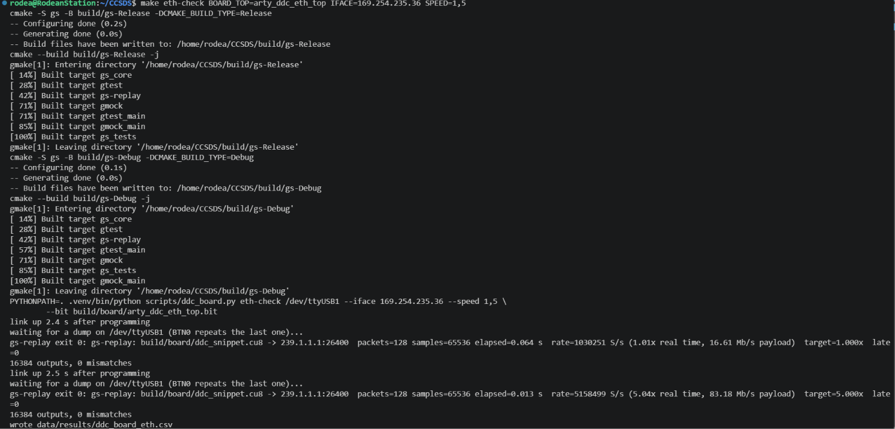

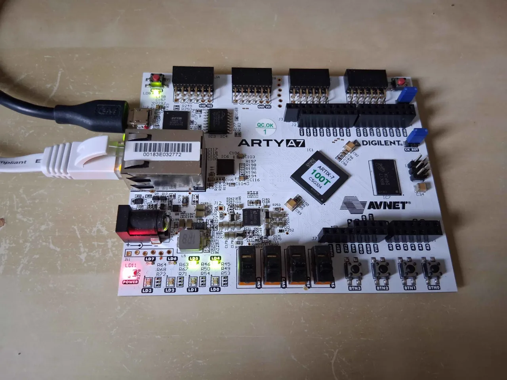

**The whole receiver.** `arty_rx_eth_top` decodes a replayed recording and sends each CADU back as a packet with its
status, plus a stats packet every 100 ms. A run of `scripts/board_gs_rx.py` on the space-packet recording, as
printed (2026-11-11, [board_gs_rx_packets.csv](data/results/board_gs_rx_packets.csv)):

```
coarse estimate 151015.5 Hz: NCO word 0x25C0FE00
link up 3.1 s after programming
gs-replay exit 0: gs-replay: data/synthetic/synthetic_packets_seed2027_1024000SPS.cu8 -> 239.1.1.1:26400  packets=68266 samples=34952192 elapsed=6.827 s  rate=5119971 S/s (5.00x real time, 82.56 Mb/s payload)  target=5.000x  late=25524
speed 5: host_tx_dropped=0 datagrams=482 ring_full=0 cadu_packets=298 cadus_good=298 cadus_rs_failed=0 cadu_seq_missing=0 malformed=0 rs_symbols_corrected=0 stats_packets=184 nco_ok=True; gs-diff satdump_frames=261 common=261 only_ours=37 only_satdump=0 data_bits_differ=0 asm_frames_differ=0 parity_bytes_differ=0 result=PASS
packets: packets=268 truth_packets=270 expected_packets=268 packets_exact=1 pd_satdump=228 pd_equal=228 pd_differ=0 pd_only_ours=40 pd_only_satdump=0 pd_explained=missing_in_satdump:40 pd_unexplained=0 pd_result=PASS
```

## Demos

| Demo | Command | On-board result |
|---|---|---|
| DDC bit-exactness over UART | `make board prog board-check` | 16,384 outputs, 0 mismatches |
| DDC bit-exactness over JTAG | `make board ILA=1 && make ila-capture` | 16,384 outputs, 0 mismatches |
| DDC bit-exactness over Ethernet | `make board BOARD_TOP=arty_ddc_eth_top && make eth-check BOARD_TOP=arty_ddc_eth_top IFACE=<host IP on the cable> SPEED=1,5` | 16,384 outputs, 0 mismatches per replay (38 of 40) |
| Whole receiver, CADUs vs. truth | `make board BOARD_TOP=arty_rx_eth_top && make rx-check IFACE=<host IP on the cable> SPEED=1,5,5.6` | 298 / 298 CADUs per replay, 15 / 15 replays |
| Board → ground station vs. SatDump | `PYTHONPATH=. python scripts/board_gs_rx.py REC.cu8 SATDUMP.cadu --iface <IP> --speed 1,5,5.6 [--truth T.cadu T.packets]` | All frames SatDump decoded bit-identical; packets equal to the model's |
| Replay a recording over UDP | `build/gs-Release/gs-replay FILE.cu8 [--speed X]` | Into the board (rows above) |
| Demo video | — | `[TBD]` (Phase F) |

Claim the shared board first: `python3 ~/fpga-coord/coord.py board claim P3 "<reason>"`.

## In Vivado

| Build | Timing | Utilization | Reports |
|---|---|---|---|
| `ddc_top`, out of context | WNS +0.661 ns, WHS +0.112 ns, 100 MHz | 1,036 LUT, 1,659 FF, 6 DSP, 1 RAMB18 | [docs/reports/ooc/ddc_top/](docs/reports/ooc/ddc_top/) |
| Board bring-up | WNS +1.521 ns, WHS +0.040 ns | 1,095 LUT, 1,853 FF, 6 DSP, 48 RAMB36 (ROM + capture), 1 RAMB18 | [docs/reports/board/arty_ddc_rom_top/](docs/reports/board/arty_ddc_rom_top/) |
| Board bring-up + ILA | WNS +1.750 ns, WHS +0.024 ns | 2,544 LUT, 4,314 FF, 6 DSP, 64 RAMB36, 1 RAMB18 | [docs/reports/board/arty_ddc_rom_top_ila/](docs/reports/board/arty_ddc_rom_top_ila/) |
| DDC over Ethernet | WNS +0.277 ns, WHS +0.022 ns | 2,457 LUT, 4,740 FF, 6 DSP, 18 RAMB36, 4 RAMB18 | [docs/reports/board/arty_ddc_eth_top/](docs/reports/board/arty_ddc_eth_top/) |
| **Whole receiver** | WNS +0.256 ns, WHS +0.025 ns | 13,682 LUT, 13,984 FF, 29 DSP, 8 RAMB36, 7 RAMB18 | [docs/reports/board/arty_rx_eth_top/](docs/reports/board/arty_rx_eth_top/) |
| Whole receiver, CADUs before RS (BER build) | WNS +0.074 ns, WHS +0.027 ns | 13,681 LUT, 13,931 FF, 29 DSP, 8 RAMB36, 7 RAMB18 | [docs/reports/board/arty_rx_eth_top_prers/](docs/reports/board/arty_rx_eth_top_prers/) |

Device view, worst-path and schematic screenshots: `[TBD]`, listed for capture in
[portfolio-todo.md](docs/portfolio-todo.md).

## Results

Part `xc7a100tcsg324-1`, Vivado 2025.2, 100 MHz. All inputs synthetic until a real recording exists.

| Metric | Value | Conditions | Source |
|---|---|---|---|
| Uncoded BER vs. theory | Within counting error, 0–8 dB | Float model, AWGN | [ber_awgn.csv](data/results/ber_awgn.csv) |
| Soft Viterbi BER | 1.79×10⁻⁵ at 4.0 dB (union bound 1.81×10⁻⁵) | Float model, ≥ 100 errors per point | [ber_awgn.csv](data/results/ber_awgn.csv) |
| Eb/N₀ at 10⁻⁵, by soft width | 4.15 (unquantized) / 4.28 (4-bit) / 4.39 (3-bit) dB | Before NRZ-M, AWGN symbol channel | [soft_width_ber.csv](data/results/soft_width_ber.csv) |
| Full-chain frames | 190 / 200 from 2.5 dB; 183 at 2.0 dB | 1 kHz offset, 30 Hz/s ramp, 0.37-symbol timing offset, 20 ppm clock; the 10 missing are run edges | [fer_full_chain.csv](data/results/fer_full_chain.csv) |
| SatDump on our synthetic recording | 258 / 295 / 226 of 300 decoded; all match | 1 kHz + 30 Hz/s / 0 Hz / 1 kHz static | [satdump_crosscheck.csv](data/results/satdump_crosscheck.csv) |
| NCO SFDR | 71.6–72.8 dB | 64 random tuning words | [ddc_nco_sfdr.csv](data/results/ddc_nco_sfdr.csv) |
| Bit-true DDC SQNR | 51.0–53.7 dB | 2–8 dB Eb/N₀ | [ddc_fixed_chain.csv](data/results/ddc_fixed_chain.csv) |
| Frequency tracking error | 1.7–4.0 Hz rms | Bit-true, 1 and 3.4 kHz offsets, 30 Hz/s ramp | [sync_fixed_chain.csv](data/results/sync_fixed_chain.csv) |
| DDC RTL vs. model | 6,000 / 6,000 outputs bit-exact | Verilator, random backpressure, 6 dB OQPSK | [ddc_rtl_sim.csv](data/results/ddc_rtl_sim.csv) |
| DDC throughput | 9.0 clocks/sample, 10.8× real time | RTL simulation, 100 MHz | [ddc_rtl_sim.csv](data/results/ddc_rtl_sim.csv) |
| RRC RTL vs. model | 4,000 / 4,000 outputs bit-exact | Verilator, random backpressure, bit-true DDC output of 6 dB OQPSK | [rrc_rtl_sim.csv](data/results/rrc_rtl_sim.csv) |
| RRC throughput | 62 clocks/sample, 6.3× real time | RTL simulation, 100 MHz | [rrc_rtl_sim.csv](data/results/rrc_rtl_sim.csv) |
| AGC RTL vs. model | 16,500 / 16,500 outputs bit-exact | Verilator, random backpressure, RRC output of 6 dB OQPSK + full-scale burst | [agc_rtl_sim.csv](data/results/agc_rtl_sim.csv) |
| AGC throughput | 6 clocks/sample, 65× real time | RTL simulation, 100 MHz | [agc_rtl_sim.csv](data/results/agc_rtl_sim.csv) |
| Costas RTL vs. model | 26,000 / 26,000 outputs bit-exact; locks to the residual | Verilator, random backpressure, AGC output of 6 dB OQPSK, 50 Hz residual + 30 Hz/s | [costas_rtl_sim.csv](data/results/costas_rtl_sim.csv) |
| Costas throughput | 10 clocks/sample, 39× real time | RTL simulation, 100 MHz | [costas_rtl_sim.csv](data/results/costas_rtl_sim.csv) |
| Timing RTL vs. model | 14,619 / 14,619 outputs bit-exact; pulls in from a half-symbol offset (eye 2.08 vs. 1.48 with no loop) | Verilator, random backpressure, Costas output of 6 dB OQPSK; 100 ppm + integrator clamp run | [timing_rtl_sim.csv](data/results/timing_rtl_sim.csv) |
| Timing throughput | 9.42 clocks/input sample, 41× real time | RTL simulation, 100 MHz | [timing_rtl_sim.csv](data/results/timing_rtl_sim.csv) |
| Sync chain RTL vs. model | 8,436 / 8,436 outputs bit-exact | Verilator, input gaps + output slower than the chain; DDC output of 6 dB OQPSK, 1 kHz + 30 Hz/s, 0.37 symbol, 20 ppm; loops from reset | [sync_top_rtl_sim.csv](data/results/sync_top_rtl_sim.csv) |
| Sync chain throughput | 62 clocks/input sample, 6.3× real time | RTL simulation, 100 MHz | [sync_top_rtl_sim.csv](data/results/sync_top_rtl_sim.csv) |
| Lock range (with coarse estimate) | −15 to +14 kHz, lock in 16–35 ms; +16 and −20 kHz don't lock | Bit-true chain = RTL, from reset, 6 dB, 30 Hz/s, 4 seeds | [sync_lock_range.csv](data/results/sync_lock_range.csv) |
| Costas pull-in (no coarse estimate) | ≤ 100 Hz: 19–158 ms; 150 Hz: 238–314 ms; 300 Hz: 0.9–1.2 s, 1 of 4 seeds no lock | Same | [sync_lock_costas.csv](data/results/sync_lock_costas.csv) |
| Doppler tracking | 0.84 Hz rms, 3.0 Hz max after 0.1 s; 38 / 40 frames | 30 Hz/s through zero, 4.6 s, 6 dB | [sync_doppler_track.csv](data/results/sync_doppler_track.csv) |
| Viterbi RTL vs. model | 3,904 + 2,904 bits bit-exact; at 1.5 dB the same 93 errors as the model | Verilator, random gaps and stalls; depth 96 from state 0 | [viterbi_rtl_sim.csv](data/results/viterbi_rtl_sim.csv) |
| Frame-sync RTL vs. model | 13 scenarios, 59 windows, 492,768 pairs bit-exact; early, dropped (12,976 at thr 16/64) and slip counts equal | Verilator, input gaps, sink slower than the input; 4 hypotheses, flywheel, lock loss, slips 0/−1/+2/tie, noise | [framesync_rtl_sim.csv](data/results/framesync_rtl_sim.csv) |
| Viterbi throughput | 96 clocks/bit, 14.5× real time | RTL simulation, 100 MHz | [viterbi_rtl_sim.csv](data/results/viterbi_rtl_sim.csv) |
| Sync chain output decoded | 1 CADU decoded, 1 matching, 0 wrong (3 sent; cold start) | 87,388 samples, 49,156 outputs bit-exact; model back end | [sync_chain_rtl_decode.csv](data/results/sync_chain_rtl_decode.csv) |
| Chain to CADUs decoded (RTL after the DDC) | 5 of 5 CADUs match a frame sent (7 sent; cold start); 5,120 bytes and 5 status words bit-exact; RS 0 corrected, 0 failed | 203,897 samples, 6 dB; sink held until stalls reach the input (3 stalls) | [rx_chain_rtl_decode.csv](data/results/rx_chain_rtl_decode.csv) |
| DDC on the board (UART) | 16,384 / 16,384 bit-exact | 65,536-sample snippet, 8 dB | [ddc_board.csv](data/results/ddc_board.csv) |
| DDC on the board (ILA) | 16,384 / 16,384 bit-exact | Same snippet, JTAG | [ddc_board_ila.csv](data/results/ddc_board_ila.csv) |
| DDC on the board over Ethernet | 38 / 40 replays bit-exact (1×: 10/10, 5×: 9/10, 5.6×: 19/20); the 2 others received every datagram intact but reordered before the cable (board counters: no Ethernet errors, ingest gaps) | Same snippet, `gs-replay` → eth-core → `iq_udp_ingest`, FPGA reprogrammed per replay; counters from the board's stats packets | [ddc_board_eth.csv](data/results/ddc_board_eth.csv) |
| Ethernet board top timing | WNS +0.277 ns, WHS +0.022 ns; 2,457 LUT, 18 RAMB36 + 4 RAMB18, 6 DSP | `arty_ddc_eth_top` with the stats TX path, 100 MHz, placed and routed | [board_arty_ddc_eth_top.csv](data/results/board_arty_ddc_eth_top.csv) |
| `gs-replay` on loopback | 68,266 / 68,266 in order, byte-exact at 1× and 5× | 34 s synthetic recording, WSL2 | [gs_replay_loopback.csv](data/results/gs_replay_loopback.csv) |
| Board top, simulation (MII in → CADU packets out) | 3 / 3 CADU packets bit-exact with the model, 501 stats packets intact, 0 loss at the 100 Mb/s line rate | 1,137 datagrams back to back (5.69×), 6 dB, `arty_rx_eth_top` from reset | [rx_top_rtl_decode.csv](data/results/rx_top_rtl_decode.csv) |
| Whole receiver on the board | 15 / 15 replays: 298 CADU packets each, all matching the truth (892 data bytes), 0 RS symbols corrected, 0 codewords failed; one replay recovered from 14 MAC restarts at link-up (request 0005 stopgap) | Synthetic recording (300 CADUs, 8 dB, 34 s), `gs-replay` asked 1×, 5×, 5.6× (achieved 1.00, 3.4–4.2, 5.1–5.5), NCO word by SET_NCO, board reprogrammed per replay | [board_rx_eth.csv](data/results/board_rx_eth.csv) |
| Board → `gs-rx` → `gs-diff` vs. SatDump | 298 / 298 CADUs received per replay at 1×, 5×, 5.39×; all 258 frames SatDump decoded bit-identical | Synthetic recording, 8 dB; SatDump 1.2.2 | [board_gs_rx.csv](data/results/board_gs_rx.csv) |
| Board → `gs-rx` space packets vs. truth and SatDump | Packets equal the model's demux of the delivered frames in 3 / 3 replays (268 / 270 at 1×, 5×); 228 equal to SatDump, 0 different, 0 unexplained | Synthetic recording with VCID-5 packets (seed 2027, 8 dB); at 5.6× the host dropped 2 datagrams | [board_gs_rx_packets.csv](data/results/board_gs_rx_packets.csv) |
| Receiver board top timing | WNS +0.256 ns, WHS +0.025 ns; 13,682 LUT, 8 RAMB36 + 7 RAMB18, 29 DSP | `arty_rx_eth_top`, 100 MHz, placed and routed | [board_arty_rx_eth_top.csv](data/results/board_arty_rx_eth_top.csv) |
| Real passes decoded / CADU match vs. SatDump | This receiver: `[TBD]`. SatDump: 1 pass, 4,583 CADUs | Meteor-M N2-4, 2026-11-21, 75.7° max | [MANIFEST](data/MANIFEST.md) |
| Hardware BER, Viterbi + NRZ-M (pre-RS) | 1.79×10⁻⁴ at 3.5 dB, 4.85×10⁻⁶ at 4.5 dB; 0.12–0.36 dB from the model, 2–4.5 dB | Arty, synthetic AWGN replay, ≥ 100 errors per point | [ber_board.csv](data/results/ber_board.csv) |
| Hardware BER, Viterbi + RS (data bytes) | 9.64×10⁻⁵ at 2.5 dB; 0 errors in 42.5 M bits at each of 3–5 dB (< 7.0×10⁻⁸) | Same; 20 recordings per point from 3 dB | [ber_board.csv](data/results/ber_board.csv) |
| Hardware BER, uncoded | Not measured: no tap before the Viterbi decoder | — | — |

## Limitations

- **No real signal yet.** Every result is on synthetic signals. The signal spec comes from SatDump's source, and
  which rail leads and which carries G1 are still open until a real recording is decoded.
- **Recorded, not live RF.** By design, the board never sees RF. An RTL-SDR records on the host and the file is
  replayed.
- **Bit-true doesn't mean robust.** The model hasn't seen phase noise, interference, fading or a real RTL-SDR's
  impairments.
- **Hardware BER is on synthetic AWGN only.** Fixed carrier offset, timing offset and clock error; no Doppler ramp,
  fading or real-recording impairment.
- **Throughput figures are partly arithmetic.** The per-block speeds (DDC 10.8×, sync chain 6.3×, Viterbi 14.5×)
  are measured in simulation, and replays up to 5.6× decode on the board; the 5.69× Ethernet ceiling is calculated.
- **Hold slack on the ILA build is +0.024 ns:** positive but thin. It's the debug build only.
- **The host reorders replay datagrams now and then** (2 of 40 replays of the DDC build). The receiver's ingest
  has a reorder buffer that puts them back (`ingest_late` counts any that arrive too late); 0 gaps in the
  15-replay campaign ([board_rx_eth.csv](data/results/board_rx_eth.csv)).
- **A loaded host drops replay datagrams** before they reach the wire: the kernel's `tx_dropped` on the USB-Ethernet
  adapter equals the board's `ingest_lost` (2 at 5.6× at load ~16 on 16 cores,
  [board_gs_rx_packets.csv](data/results/board_gs_rx_packets.csv)). A lost datagram is a 512-sample gap; RS gates
  out the frames it damages. Replay real passes on a quiet host, or at 1×.
- **eth_rx's RX FIFO can come up corrupted at PHY link-up** (1 in 20 reprograms on 2026-11-07, all after slow
  link-ups). Reported to fpga-eth-core's owner (request 0005); until it holds the MAC in reset until link-up,
  the top detects the impossible FIFO level and restarts the MAC. That stopgap is tested in simulation; it
  fired once on hardware (2026-11-11: 14 restarts before the replay began, then every CADU decoded;
  [board_rx_eth.csv](data/results/board_rx_eth.csv)).
- **Opening the serial port reset the ROM design on 2026-11-04 but not the Ethernet design on 2026-11-07; why is
  not established.** The CRC on the UART dump makes the check immune to a reset, and `eth-check` reprograms the FPGA
  before each replay rather than rely on one.
- **72k mode only.** If the satellite switches to 80k (interleaved) mode, this receiver won't decode it.
- **Fuzzing is short so far.** 30 s per target in every CI run (no crash yet); the weekly 30-minute run has not run yet.

## Build and reproduce

Prerequisites, with versions in [docs/toolchain.md](docs/toolchain.md):
- Python 3.11+ (3.14.4 used) with a venv from `make setup` (cocotb 2.1.0 and [tb-common](https://github.com/RodeanAzari/tb-common) pinned in `requirements.txt`)
- Verilator 5.050
- Vivado 2025.2, run in batch through `scripts/vivado.sh`
- CMake ≥ 3.24 and a C++20 compiler (GoogleTest is fetched at a pinned hash)
- SatDump 1.2.2
- openFPGALoader; on WSL, the board is attached with usbipd-win

| Target | Does |
|---|---|
| `make setup` | Create `.venv`, install pinned requirements |
| `make lint` | Verilator `-Wall`, each module as its own top, zero warnings |
| `make lint-py` | ruff + mypy `--strict` on `model/` |
| `make model-test` | Signal-spec check, RTL-table staleness check, pytest |
| `make sim` / `make sim-slow` | cocotb regression on Verilator (< 5 min) / the frame-sync suite (~100 s) |
| `make sim-full` | Long cocotb runs: the sync chain from reset, its output decoded (~4 min); the chain through the Viterbi (~10 min) |
| `make cov` | Functional coverage over `make sim`, `sim-slow` and `sim-full`; fails on a missed bin (~70 min) |
| `make formal` | SymbiYosys: Viterbi path-metric bound (unbounded) and hold proof, AXI4-Stream handshakes on 17 blocks, frame sync FSM (~28 min) |
| `make gs` / `make gs-test` | Ground station, Release + Debug (ASan/UBSan); GoogleTest + loopback |
| `make gs-lint` | clang-format check, clang-tidy (warnings are errors, every disabled check justified in `gs/.clang-tidy`), cppcheck |
| `make fuzz [FUZZ_S=60]` / `make fuzz-ci` | libFuzzer on both packet parsers / 30 s each |
| `make ci` | lint-py, lint, model-test, sim, sim-slow, gs-test, gs-lint, fuzz-ci |
| `make synthetic-iq` | Write the synthetic pass-like recording and its truth |
| `make synth` / `make impl` | The receiver out of context (`rx_chain`) / the board top placed and routed (`arty_rx_eth_top`) |
| `make reports TAG=<tag>` | Freeze every build's timing and utilization in `docs/reports/<tag>/`; refuses negative slack |
| `make synth-ooc TOP=<top>` | Out-of-context synthesis and place & route, reports and CSV |
| `make board [ILA=1]` / `make prog` | Board bitstream (optionally with the ILA) / program the Arty |
| `make board-check` / `make ila-capture` | Read back and check the DDC output over UART / JTAG |
| `make eth-check` / `make rx-check` | Replay over Ethernet and check the DDC dump / every CADU against the truth |
| `make gs-replay-results` | Measure `gs-replay` on loopback |
| `make ber`, `*-study` | Model campaigns that write `data/results/` |
| `make plots` | Regenerate every plot from `data/results/` |

`make ci` runs everything that doesn't need Vivado or the board, and [GitHub Actions](https://github.com/RodeanAzari/ccsds-meteor-lrpt-receiver/actions/workflows/ci.yml) runs it on every push in an `ubuntu:26.04` container, so its compiler, clang-tidy, cppcheck, CMake, Python and Verilator (v5.050, built from source) match the development machine. Vivado and the board are local only, and their reports and CSVs are committed with the RTL that
produced them. `make sim-full` and `make cov` are local only. `make formal` runs in
[a weekly workflow](https://github.com/RodeanAzari/ccsds-meteor-lrpt-receiver/actions/workflows/formal-weekly.yml)
(and on demand) with the pinned oss-cad-suite.

## Repository layout

| Path | Contents |
|---|---|
| `rtl/ddc/` | Ingest + DC block, NCO + mixer, CIC, droop FIR, `ddc_top` |
| `rtl/sync/` | RRC, AGC, Costas, Farrow/Gardner, `sync_top` |
| `rtl/fec/` | Soft quantizer, frame sync, Viterbi, frame extract (NRZ-M), `fec_cadu` (ASM check, derandomizer, RS ×4) |
| `rtl/io/`, `rtl/top/`, `rtl/lib/` | Ethernet ingest, commands, CADU and stats packets, ROM source and UART dump; `rx_chain` and the Arty tops; synchronizers and Xilinx wrappers |
| `rtl/eth/`, `rtl/rs/` | Submodules: fpga-eth-core, fpga-rs-core (never edited here) |
| `model/` | Float receiver, transmit chain and channel, RS codec, bit-true DDC / RRC / sync / frame sync / Viterbi / CADU, space packets |
| `tb/cocotb/`, `tb/formal/` | cocotb testbenches; SymbiYosys proofs |
| `gs/` | C++ ground station (`gs-replay`, `gs-rx`, `gs-diff`, `gs-view`), GoogleTest, loopback tests, fuzz targets |
| `analysis/` | Campaigns, plots, result interpretations |
| `scripts/` | Board checks, table generation, SatDump cross-check, Vivado wrapper |
| `syn/`, `constr/` | Vivado Tcl (OOC, board, ILA capture), XDC |
| `data/results/` | Every CSV behind a reported number, each with a sidecar |
| `docs/` | Signal spec, design, ADRs, fixed point, protocol, toolchain, lab notebook, reports, media |

## Roadmap

1. **A real recording:** captured and decoded by SatDump on 2026-11-21. Next: confirm the spec and the model on it
   (Phases 0 and A).
2. **The real pass on the board:** lock (Phase C), decode it bit for bit against SatDump (Phases D, E), and recover
   its space packets and image through the ground station (Phase F); then the hero image and the demo video.

## License

[MIT](LICENSE), for everything in this repository. The `rtl/eth/` submodule is a separate repository,
[fpga-eth-core](https://github.com/RodeanAzari/fpga-eth-core), under its own terms. The Arty pin assignments in
`constr/` follow Digilent's Arty-A7-100-Master.xdc (MIT).
